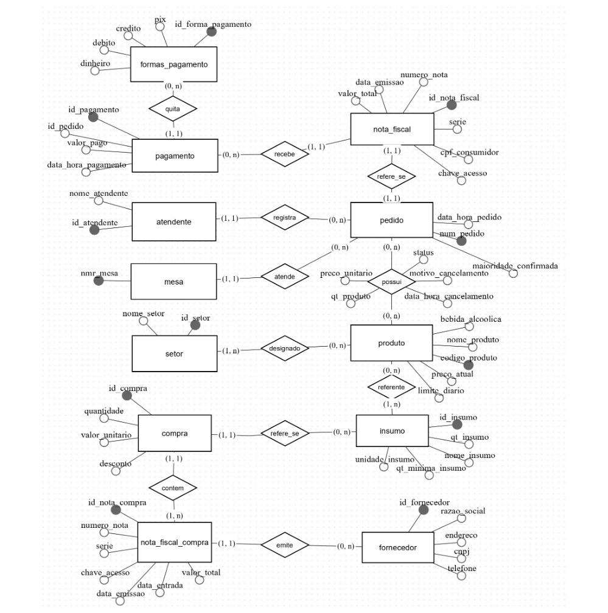

# Diagrama Entidade-Relacionamento — Palazio del Chef

## Sobre o diagrama

O Diagrama Entidade-Relacionamento (DER) do **Palazio del Chef** representa as entidades, os atributos, os relacionamentos e as cardinalidades do banco de dados de pedidos do restaurante. Ele foi feito no BRModelo e é a base do modelo relacional (pasta `modelo_relacional`) e do banco implementado em MySQL (`banco-de-dados-palazio.sql`).

  

## Entidades

O diagrama tem **12 entidades**:

| Entidade | O que representa |
| :--- | :--- |
| `atendente` | Funcionários que registram os pedidos |
| `mesa` | Mesas do salão |
| `pedido` | Pedidos (comandas), com data, hora e conferência de maioridade |
| `produto` | Itens do cardápio, com preço atual, limite diário e indicação de bebida alcoólica |
| `setor` | Setor de preparo do produto (cozinha ou bar) |
| `insumo` | Insumos em estoque, com quantidade, unidade e quantidade mínima |
| `formas_pagamento` | Formas de pagamento aceitas (dinheiro, débito, crédito e pix) |
| `pagamento` | Pagamentos de um pedido, com valor e data |
| `nota_fiscal` | NFC-e emitida para o pedido |
| `fornecedor` | Fornecedores de insumos |
| `nota_fiscal_compra` | Notas fiscais de compra emitidas pelos fornecedores |
| `compra` | Compras de insumos, com quantidade, valor unitário e desconto |

## Relacionamentos e cardinalidades

| Relacionamento | Entidades | Cardinalidade |
| :--- | :--- | :--- |
| registra | atendente e pedido | Um atendente registra vários pedidos; cada pedido tem um atendente |
| atende | mesa e pedido | Uma mesa atende vários pedidos; cada pedido tem uma mesa |
| possui | pedido e produto | Muitos para muitos. Guarda quantidade, preço unitário, status, motivo e data de cancelamento (vira a tabela `item_pedido`) |
| designado | produto e setor | Cada produto pertence a um setor; um setor tem vários produtos |
| referente | produto e insumo | Liga o produto ao insumo que ele consome no estoque |
| quita | pagamento e formas_pagamento | Cada pagamento tem uma forma; uma forma está em vários pagamentos |
| recebe | pagamento e nota_fiscal | O pagamento pode ser ligado a uma nota fiscal (a nota é opcional no momento do pagamento) |
| refere-se | nota_fiscal e pedido | Cada nota refere-se a um pedido, e cada pedido tem no máximo uma nota |
| refere-se | compra e insumo | Cada compra é de um insumo |
| contém | compra e nota_fiscal_compra | Uma nota de compra contém várias compras |
| emite | nota_fiscal_compra e fornecedor | Cada nota de compra é emitida por um fornecedor |

## Revisão em relação à Entrega 1

O DER da Entrega 1 tinha 5 entidades (atendente, mesa, pedido, produto e setor). Esta versão acrescenta pagamento, nota fiscal, estoque de insumos, fornecedores e compras, que cobrem os processos de pagamento e controle de estoque mapeados na análise. O quadro completo da revisão está na seção 6.1 do [README principal](../README.md).

## Documentos relacionados

- [Dicionário de dados](../dicionario_dados_palazio/)
- [Modelo relacional](../modelo_relacional/)

[🔝 Voltar ao início](https://github.com/thiago-rodrigues-S6/projeto-banco-de-dados-ads)
