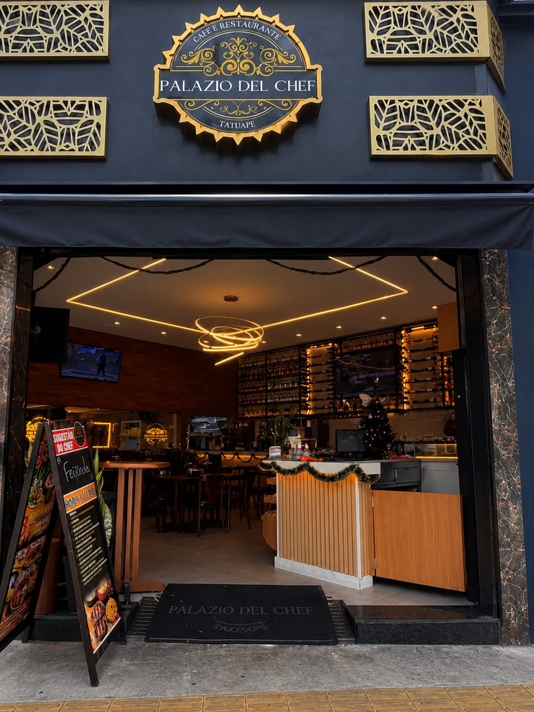
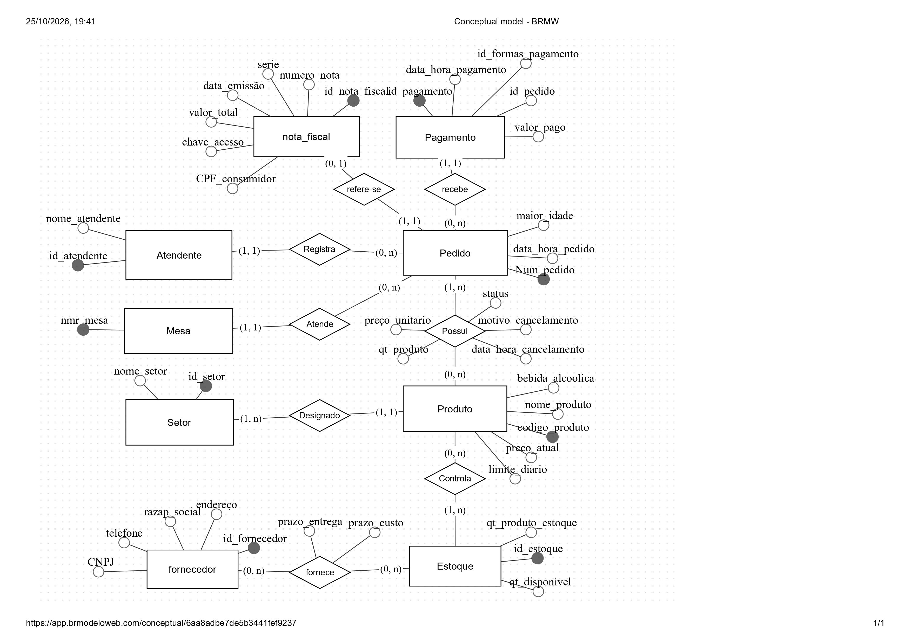

# 🍽️ Projeto: Palazio del Chef

<p align="center">
  
  
</p>

---

## 👥 1. Integrantes

- **Victor Anjos**
- **Thiago Rodrigues**
- **Ricardo Santos**
- **Raphael Luiz**

---

## 📖 2. Contextualização e Visão Geral


### 2.1 Identificação do estabelecimento

— **Nome do estabelecimento:** Palazio del Chef

— **Razão social:** Bar e Restaurante Palazio Del Chef Tatuape LTDA.

— **CNPJ:** 58759116000199

— **Endereço:** R.Apucarana, 480 - Tatuapé, São Paulo - (CEP 03311-000).

— **Telefone:** (11) 2359-7134

— **Google Maps:** https://www.google.com/maps/place/Palazio+Del+Chefe/@-23.5425015,-46.5644402,17z/data=!3m1!4b1!4m6!3m5!1s0x94ce5f0018afe5f5:0x3949505257c57a90!8m2!3d-23.5425015!4d-46.5644402!16s%2Fg%2F11x8cvzkzz?entry=ttu&g_ep=EgoyMDI2MTAxMy4wIKXMDSoASAFQAw%3D%3D

— **Redes sociais oficiais:** https://www.instagram.com/palaziodelchef/?hl=en

<p align="center">
  
</p>

--- 
### 2.2 Entrevista 


Durante a visita ao restaurante, foi realizada uma entrevista com um gerente do estabelecimento, com o objetivo de compreender seu funcionamento e levantar informações relevantes para o desenvolvimento do projeto de modelagem de banco de dados.

A conversa permitiu identificar características da operação, incluindo o atendimento aos clientes, o registro dos pedidos, o encaminhamento dos pedidos aos setores responsáveis e o gerenciamento do estoque.

Como evidência da visita realizada, apresenta-se a fotografia registrada pela equipe durante o encontro com o gerente do estabelecimento.


*Figura 2 — Registro fotográfico da equipe durante a visita ao estabelecimento.*

---

### 2.3 Levantamento de requisitos durante a entrevista. 

Durante a entrevista, foram identificadas as seguintes características do funcionamento do restaurante:

- **Modalidade de atendimento:** o restaurante não realiza entregas por delivery.
- **Registro de pedidos:** os funcionários utilizam um aplicativo para registrar os pedidos dos clientes.
- **Encaminhamento dos pedidos:** após o registro no aplicativo, os pedidos são encaminhados à cozinha ou ao bar, conforme o setor responsável por sua preparação.
- **Acesso ao aplicativo:** segundo as informações obtidas, os funcionários não possuem credenciais individuais de acesso.
- **Gerenciamento de compras e estoque:** o proprietário é responsável pelas compras dos produtos destinados ao estoque.

Essas informações servem como base para compreender os processos operacionais do restaurante e orientar a identificação dos requisitos e das regras de negócio considerados no projeto do banco de dados.


### 📍 O Estabelecimento

O **Palazio del Chef** é um estabelecimento do segmento de alimentação, com características de restaurante e bar. Possui médio porte e apresenta um fluxo considerável de clientes. Está situado na R. Apucarana, 480, no bairro do Tatuapé, em São Paulo - SP (CEP 03311-000), em uma localidade ótima pela facilidade de acesso, tanto a pé quanto de carro, moto ou outros meios motorizados. Além disso, o ambiente é arborizado, graças ao **Parque Municipal Sampaio Moreira**, localizado bem em frente ao restaurante, o que torna o entorno mais agradável para clientes e colaboradores.

A escolha do estabelecimento para o desenvolvimento do projeto ocorreu devido à sua estrutura operacional e aos processos envolvidos em seu funcionamento, possibilitando a aplicação dos conceitos de modelagem de banco de dados.

<p align="center">
  
</p>


### 🎯 Objetivo do Projeto

O projeto tem como objetivo analisar os processos do estabelecimento e desenvolver uma modelagem de banco de dados capaz de organizar as principais informações relacionadas ao atendimento, pedidos, produtos, mesas, setores e atendentes.

---

## 🔍 3. Análise e Modelagem

### 🗺️ Mapeamento de Processos


Foram mapeados os seguintes processos principais do estabelecimento:


- 🛎️ Atendimento ao cliente
- 📝 Registro do pedido
- 🍳 Preparação do pedido
- 🏃 Encaminhamento para a cozinha/bar
- 💳 Pagamento
- 📦 Controle de estoque
- 🧑‍🍳 Cadastro e controle de atendentes

---

### ⚠️ Identificação do Problema

### 💡 Solução Proposta

---

## ⚙️ 4. Requisitos e Regras de Negócio

Esta seção apresenta os requisitos funcionais e não funcionais e as regras de negócio consideradas no desenvolvimento do banco de dados do Palazio del Chef. Sua definição tem como base as informações levantadas durante a entrevista com um gerente do estabelecimento e as entidades e os relacionamentos representados no Diagrama Entidade-Relacionamento (DER).

### 4.1 Requisitos Funcionais

Os requisitos funcionais descrevem as operações que o sistema deverá permitir para apoiar o funcionamento do restaurante.

| Código | Requisito funcional |
| :--- | :--- |
| RF01 | O sistema deve permitir o registro de pedidos, associando cada pedido a uma mesa e ao atendente responsável. |
| RF02 | O sistema deve permitir a inclusão de produtos em um pedido, informando a quantidade e o preço unitário considerado para cada produto. |
| RF03 | O sistema deve permitir o cadastro e a consulta dos produtos disponíveis, incluindo nome, código e preço atual. |
| RF04 | O sistema deve permitir o cadastro e a identificação das mesas utilizadas no atendimento. |
| RF05 | O sistema deve permitir o cadastro dos atendentes responsáveis pelo registro dos pedidos. |
| RF06 | O sistema deve permitir a classificação dos produtos conforme o setor responsável por sua preparação, como cozinha ou bar. |
| RF07 | O sistema deve permitir o registro dos pagamentos relacionados aos pedidos, incluindo data, valor pago e forma de pagamento. |
| RF08 | O sistema deve permitir o registro e a consulta das quantidades de produtos disponíveis em estoque. |

### 4.2 Requisitos Não Funcionais

Os requisitos não funcionais estabelecem condições de segurança, integridade e confiabilidade para o funcionamento do sistema.

| Código | Requisito não funcional |
| :--- | :--- |
| RNF01 | O sistema deve preservar a integridade referencial dos dados por meio de chaves primárias e estrangeiras, impedindo associações inválidas entre registros. |
| RNF02 | O sistema deve garantir que os dados obrigatórios de pedidos, produtos, mesas e pagamentos sejam validados antes de sua gravação, conforme as restrições definidas no modelo. |
| RNF03 | O sistema deve implementar mecanismos de autenticação e controle de acesso para restringir operações e informações conforme as permissões dos usuários autorizados. |
| RNF04 | O sistema deve armazenar os valores monetários em tipos de dados apropriados para evitar perda indevida de precisão nos preços e pagamentos. |

### 4.3 Regras de Negócio

As regras de negócio definem condições que devem ser respeitadas para representar corretamente as operações do restaurante e manter a consistência das informações armazenadas.

**RN01 — Rastreabilidade dos pedidos:** Todo pedido registrado deve estar associado a exatamente um atendente responsável pelo seu registro.

**RN02 — Vinculação à mesa:** Todo pedido deve estar associado a exatamente uma mesa, conforme o modelo de atendimento presencial considerado no projeto.

**RN03 — Identificação dos produtos:** Cada produto cadastrado deve possuir um código identificador único (`codigo_produto`), utilizado para diferenciá-lo dos demais produtos registrados no sistema.

**RN04 — Composição dos pedidos:** Um pedido pode conter um ou mais produtos, e um mesmo produto pode estar presente em diferentes pedidos. A quantidade e o preço unitário devem ser registrados para cada associação entre pedido e produto.

**RN05 — Encaminhamento por setor:** Cada produto deve estar associado ao setor responsável por sua preparação, como cozinha ou bar, de acordo com a classificação definida no cadastro.

**RN06 — Registro de pagamentos:** Um pedido pode não possuir pagamentos registrados, possuir um único pagamento ou possuir vários pagamentos, permitindo que o valor seja quitado em etapas.

**RN07 — Controle de estoque:** As informações de estoque devem estar relacionadas aos produtos correspondentes, permitindo identificar as quantidades registradas para cada produto.

**RN08 — Integridade dos registros:** Os registros relacionados entre si devem respeitar as chaves e as restrições de integridade definidas no banco de dados, evitando referências a registros inexistentes.

**RN09 — Validação de quantidades e valores:** As quantidades e os valores numéricos não podem assumir valores negativos quando representarem quantidades físicas, preços ou valores pagos. A obrigatoriedade de preenchimento deverá ser definida individualmente para cada atributo.

**RN10 — Associação de produtos aos setores:** Cada produto deve possuir um setor responsável definido no cadastro, conforme a estrutura representada no DER.

**RN11 — Identificação e data dos pedidos:** Cada pedido deve possuir um identificador próprio e uma data de registro, permitindo sua diferenciação e consulta posterior.

**RN12 — Identificação dos pagamentos:** Cada registro de pagamento deve possuir um identificador próprio, possibilitando sua identificação individual no sistema.

### 4.4 Relação com a Modelagem do Banco de Dados

Os requisitos e as regras apresentados orientam a estruturação das entidades, dos atributos e dos relacionamentos do banco de dados. As regras referentes aos pedidos, produtos, mesas, atendentes, setores, estoque e pagamentos devem ser implementadas por meio de chaves, restrições e validações adequadas no modelo relacional.

As regras que dependem de decisões operacionais ainda não confirmadas deverão ser validadas com o estabelecimento antes da implementação definitiva do sistema.

---

## 🗄️ 5. Dicionário de Dados

O mapeamento das variáveis do sistema foi estruturado e documentado internamente com base nos parâmetros estabelecidos no portal *Datapsico*.

O modelo de banco de dados relacional é composto pelas seguintes entidades principais:

- **Atendente**
- **Mesa**
- **Pedido**
- **Produto**
- **Setor**
- **estoque**
- **pagamento**

Cada entidade possui atributos específicos, identificadores e relacionamentos definidos de acordo com as necessidades levantadas durante a análise do estabelecimento.

Os atributos são tipados de acordo com suas características, utilizando tipos como `Integer`, `Varchar`, `Date` e `Decimal`.

O modelo utiliza **Chaves Primárias (PK)** e **Chaves Estrangeiras (FK)** para estabelecer os relacionamentos e garantir a integridade dos dados.

> 📌 O dicionário de dados completo será disponibilizado na documentação do projeto.

[Ver Dicionario](./dicionario_dados_palazio/)

---

## 🔗 6. Diagrama Entidade-Relacionamento

O **Diagrama Entidade-Relacionamento (DER)** representa graficamente as entidades, atributos, relacionamentos e cardinalidades identificados durante a etapa de modelagem.

### 📊 Diagrama

<p align="center">
  
</p>

> [Ver Diagrama](./Diagrama_Palazio_del_Chef/).

---

## 🧩 7. Modelo Relacional

A partir do modelo conceitual, será desenvolvido o modelo relacional contendo as tabelas, chaves primárias, chaves estrangeiras e demais restrições necessárias para a implementação do banco de dados.

### Principais entidades

- `Atendente`
- `Pedido`
- `Produto`
- `Mesa`
- `Setor`


**Status:** ⏳ Em desenvolvimento

---

## 🧹 8. Normalização

O modelo será analisado de acordo com os princípios de normalização de bancos de dados, buscando reduzir redundâncias e evitar inconsistências nas informações armazenadas.

Serão consideradas as formas normais necessárias para garantir uma estrutura organizada e adequada às necessidades do estabelecimento.

**Status:** ⏳ Em desenvolvimento

---

## 🗃️ 9. Implementação do Banco de Dados

Após a conclusão do modelo lógico, será realizada a implementação do banco de dados utilizando SQL.

Serão consideradas:

- Criação das tabelas;
- Definição das chaves primárias;
- Definição das chaves estrangeiras;
- Restrições de integridade;
- Inserção de dados;
- Consultas SQL.

### 🛠️ Tecnologias e Ferramentas

- **SGBD:** PostgreSQL
- **Linguagem:** SQL
- **Modelagem:** BRModelo
- **Versionamento:** Git e GitHub

**Status:** ⏳ Em desenvolvimento

---

## 📋 10. Consultas SQL

Serão desenvolvidas consultas para manipulação e recuperação das informações armazenadas no banco de dados.

Entre as operações previstas estão:

- `INSERT` — inserção de dados;
- `SELECT` — consulta de dados;
- `UPDATE` — atualização de dados;
- `DELETE` — exclusão de dados;
- `JOIN` — relacionamento entre tabelas.

**Status:** ⏳ Em desenvolvimento

---

## 📁 11. Estrutura do Projeto

```text
Palazio-del-Chef/
│
├── docs/
│   └── diagrama-der.png
│
├── Diagrama_Palazio_del_Chef/
│   └── diagrama_palazio_del_chef.jpg
│
├── Fluxograma_Palazio_del_Chef/
│   └── fluxograma_palazio_del_chef.png
│
├── sql/
│   ├── create_tables.sql
│   ├── insert_data.sql
│   └── consultas.sql
│
└── README.md
```

---

## 📌 12. Status do Projeto

| Etapa | Status |
| :--- | :--- |
| Contextualização | ✅ Concluído |
| Identificação do problema | ✅ Concluído |
| Requisitos | ✅ Concluído |
| Regras de negócio | ✅ Concluído |
| Dicionário de dados | ✅ Concluído |
| Diagrama Entidade-Relacionamento | ✅ Concluído |
| Fluxograma do processo | 🔄 Em Desenvolvimento |
| Modelo relacional | ⏳ Pendente |
| Normalização | ⏳ Pendente |
| Implementação SQL | ⏳ Pendente |
| Consultas SQL | ⏳ Pendente |
| Documentação final | ⏳ Pendente |

---

## 🛠️ 13. Justificativa Técnica da Modelagem

A modelagem do banco de dados do Palazio del Chef foi desenvolvida com base nos processos operacionais identificados durante a análise do estabelecimento. O objetivo é organizar as informações relacionadas aos pedidos, produtos, mesas, atendentes e setores, estabelecendo relacionamentos que representem as regras de negócio observadas.

### Organização das Entidades

As entidades **Atendente, Mesa, Pedido, Produto e Setor** foram definidas para representar os principais elementos envolvidos no funcionamento do estabelecimento. A separação dessas informações busca evitar a concentração de dados de diferentes finalidades em uma única estrutura, facilitando a organização, a manutenção e a futura ampliação do modelo.

### Relacionamento entre Pedido e Produto

O relacionamento **Possui** foi definido entre as entidades Pedido e Produto para representar os produtos incluídos em cada pedido. Sua cardinalidade é muitos para muitos (N:M), pois um pedido pode conter vários produtos, enquanto um mesmo produto pode estar presente em diferentes pedidos.

Os atributos `quantidade` e `preco_unitario` foram associados ao relacionamento Possui, pois representam, respectivamente, a quantidade de um produto em determinado pedido e o preço unitário considerado naquela associação. Essa organização permite representar situações em que um mesmo produto aparece em pedidos diferentes, com quantidades ou preços distintos.

### Chaves e Integridade dos Dados

As chaves primárias foram definidas para identificar individualmente os registros de cada entidade. As chaves estrangeiras serão utilizadas no modelo relacional para estabelecer os vínculos entre as tabelas e preservar a integridade referencial.

A associação entre Pedido e Mesa permite identificar a mesa vinculada a cada pedido. Já a associação entre Pedido e Atendente busca possibilitar a identificação do responsável pelo registro do pedido, contribuindo para a rastreabilidade das operações.

### Representação dos Setores

A entidade Setor representa as áreas de preparação e atendimento dos produtos, como cozinha e bar. Sua inclusão busca representar a organização operacional do estabelecimento e permitir que o modelo considere o encaminhamento dos produtos ao setor responsável.

### Escolha do Modelo Relacional

O modelo relacional foi escolhido por permitir organizar os dados em tabelas conectadas por relacionamentos definidos, com chaves e restrições de integridade. A estrutura será analisada quanto à normalização, buscando reduzir redundâncias e prevenir inconsistências no armazenamento das informações.

A modelagem também considera a possibilidade de expansão futura, conforme novos requisitos sejam identificados, sem perder a organização dos dados já representados.

### Tecnologias e Ferramentas

O BRModelo foi utilizado para apoiar a elaboração do Diagrama Entidade-Relacionamento (DER). O PostgreSQL foi definido como Sistema Gerenciador de Banco de Dados (SGBD) para a futura implementação, utilizando SQL para a criação das estruturas, definição das restrições e execução de consultas. O Git e o GitHub são utilizados para o versionamento e a organização dos arquivos do projeto.

---

## 🤖 14. Uso de Inteligência Artificial

Durante o desenvolvimento deste projeto, foi utilizado o ChatGPT (OpenAI) como ferramenta de apoio na organização, estruturação e revisão da documentação do projeto, especialmente na elaboração e formatação deste arquivo README.md.

A ferramenta foi utilizada como auxílio para melhorar a clareza das informações, organização das seções, descrição dos conteúdos e padronização da documentação.

As informações referentes ao estabelecimento, requisitos, regras de negócio, entidades, atributos e decisões de modelagem foram definidas e revisadas pelos integrantes do grupo.

---

## 🎓 14. Contexto Acadêmico

Projeto desenvolvido como atividade acadêmica da disciplina de Modelagem de Banco de Dados, aplicando conceitos de levantamento de requisitos, modelagem conceitual, entidades, atributos, relacionamentos, cardinalidade, chaves e normalização.

