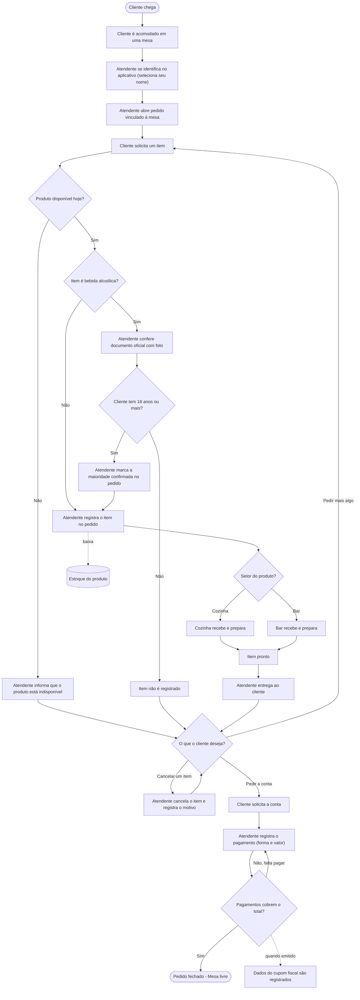

# 🍽️ Projeto: Palazio del Chef

<p align="center">
  
  
</p>

---

## 👥 1. Integrantes

- **Victor Anjos**
- **Thiago Rodrigues**
- **Ricardo Santos**
- **Raphael Luiz**

---

## Sumário

---

1. [Integrantes](#-1-integrantes)
2. [Contextualização e Visão Geral](#-2-contextualização-e-visão-geral)
3. [Análise e Modelagem](#-3-análise-e-modelagem)
4. [Requisitos e Regras de Negócio](#-4-requisitos-e-regras-de-negócio)
5. [Dicionário de Dados](#-5-dicionário-de-dados)
6. [Diagrama Entidade-Relacionamento](#-6-diagrama-entidade-relacionamento)
7. [Modelo Relacional](#-7-modelo-relacional)
8. [Normalização](#-8-normalização)
9. [Implementação do Banco de Dados](#-9-implementação-do-banco-de-dados)
10. [Consultas SQL](#-10-consultas-sql)
11. [Estrutura do Projeto](#-11-estrutura-do-projeto)
12. [Status do Projeto](#-12-status-do-projeto)
13. [Justificativa Técnica da Modelagem](#-13-justificativa-técnica-da-modelagem)
14. [Uso de Inteligência Artificial](#-14-uso-de-inteligência-artificial)
15. [Contexto Acadêmico](#-15-contexto-acadêmico)

---
---
---

## 📖 2. Contextualização e Visão Geral


### 2.1 Identificação do estabelecimento

— **Nome do estabelecimento:** Palazio del Chef

— **Razão social:** Bar e Restaurante Palazio Del Chef Tatuape LTDA.

— **CNPJ:** 58759116000199

— **Endereço:** R.Apucarana, 480 - Tatuapé, São Paulo - (CEP 03311-000).

— **Telefone:** (11) 2359-7134

— **Google Maps:** https://acesse.one/PalazioDelChefe

— **Redes sociais oficiais:** https://www.instagram.com/palaziodelchef/?hl=en


<p align="center">
  
</p>

--- 
### 2.2 Entrevista 


Durante a visita ao restaurante, foi realizada uma entrevista com um gerente do estabelecimento, com o objetivo de compreender seu funcionamento e levantar informações relevantes para o desenvolvimento do projeto de modelagem de banco de dados.

A conversa permitiu identificar características da operação, incluindo o atendimento aos clientes, o registro dos pedidos, o encaminhamento dos pedidos aos setores responsáveis e o gerenciamento do estoque.

Como evidência da visita realizada, apresenta-se a fotografia registrada pela equipe durante o encontro com o gerente do estabelecimento.

<p align="center">
  
</p>

*Figura 2 — Registro fotográfico da equipe durante a visita ao estabelecimento.*

---

### 2.3 Levantamento de requisitos durante a entrevista. 

Durante a entrevista, foram identificadas as seguintes características do funcionamento do restaurante:

- **Modalidade de atendimento:** o restaurante não realiza entregas por delivery.
- **Registro de pedidos:** os funcionários utilizam um aplicativo para registrar os pedidos dos clientes.
- **Encaminhamento dos pedidos:** após o registro no aplicativo, os pedidos são encaminhados à cozinha ou ao bar, conforme o setor responsável por sua preparação.
- **Acesso ao aplicativo:** segundo as informações obtidas, os funcionários não possuem credenciais individuais de acesso.
- **Gerenciamento de compras e estoque:** o proprietário é responsável pelas compras dos produtos destinados ao estoque.

Essas informações servem como base para compreender os processos operacionais do restaurante e orientar a identificação dos requisitos e das regras de negócio considerados no projeto do banco de dados.


---

## 🔍 3. Análise e Modelagem

Esta etapa apresenta a análise do funcionamento do Palazio del Chef, considerando as informações obtidas durante a visita ao estabelecimento e a entrevista realizada com um gerente. A partir desse levantamento, são descritos os principais processos de negócio, a necessidade de organização das informações e a solução proposta por meio da modelagem de um banco de dados relacional.

### 3.1 Caracterização do estabelecimento

O Palazio del Chef é um estabelecimento do segmento de alimentação, com características de restaurante e bar, localizado no bairro do Tatuapé, em São Paulo - SP. Seu funcionamento envolve atividades relacionadas ao atendimento presencial dos clientes, ao registro de pedidos, à preparação de produtos e ao gerenciamento de informações operacionais.

Durante a visita ao estabelecimento, foi realizada uma entrevista com um gerente para compreender aspectos de sua operação. Conforme as informações obtidas, os atendentes utilizam um aplicativo para registrar os pedidos dos clientes. Após o registro, os pedidos são encaminhados à cozinha ou ao bar, de acordo com o setor responsável pela preparação dos produtos.

Em relação ao gerenciamento de estoque, foi informado que o proprietário é responsável pelas compras dos produtos destinados ao abastecimento do estabelecimento. O controle das quantidades é realizado manualmente, por meio de planilhas, anotações ou contagem física, conforme as práticas utilizadas no gerenciamento do estoque.

Também foi informado que os funcionários não possuem credenciais individuais de acesso ao aplicativo utilizado para registrar os pedidos. Essa característica foi considerada no levantamento das informações relevantes para o projeto.

O restaurante realiza atendimento presencial e não oferece serviço de delivery, conforme informado durante a entrevista. Essas características contribuem para delimitar os processos considerados na modelagem e identificar as informações que deverão ser representadas no banco de dados proposto.

### 3.2 Objetivo do projeto

O projeto tem como objetivo desenvolver a modelagem de um banco de dados relacional capaz de organizar e relacionar as principais informações envolvidas nas operações do Palazio del Chef.

A proposta contempla a representação dos dados relacionados aos pedidos, produtos, mesas, atendentes, setores, pagamentos e estoque, considerando os processos identificados durante a análise do estabelecimento.

Por meio da definição de entidades, atributos, relacionamentos, cardinalidades e restrições de integridade, busca-se estruturar os dados de maneira consistente, permitindo representar as relações entre os elementos envolvidos nas operações do restaurante.

A modelagem também servirá de base para a construção do modelo relacional e para a futura implementação utilizando PostgreSQL e SQL, conforme as etapas previstas no projeto acadêmico.

### 3.3 Mapeamento dos processos de negócio

O mapeamento dos processos de negócio busca representar as principais atividades realizadas no estabelecimento, identificando as etapas conhecidas, os participantes envolvidos e as informações relacionadas a cada operação.

Com base nas informações levantadas durante a entrevista, foram identificados os seguintes processos:

**a) Atendimento ao cliente**

O atendimento ocorre presencialmente, com os clientes utilizando as mesas do estabelecimento e sendo atendidos pelos atendentes responsáveis. Na modelagem proposta, a associação entre mesas, pedidos e atendentes permitirá representar as informações relacionadas ao atendimento.

**b) Registro do pedido**

Os atendentes utilizam um aplicativo para registrar os pedidos realizados pelos clientes. No banco de dados proposto, esse processo será representado pelas entidades Pedido, Produto, Mesa e Atendente, permitindo relacionar cada pedido à mesa correspondente, identificar o atendente responsável pelo registro e armazenar os produtos solicitados, suas quantidades e seus preços unitários.

Na venda de bebidas alcoólicas, a modelagem propõe que o produto seja identificado como bebida alcoólica (atributo `bebida_alcoolica` da entidade Produto) e que o pedido registre se a maioridade do cliente foi confirmada (atributo `maioridade_confirmada` da entidade Pedido). Pela regra proposta, antes de registrar um item alcoólico, o atendente solicita ao cliente um documento oficial com foto e confere se ele tem 18 anos ou mais. O documento é apenas visualizado e nenhum dado dele é armazenado, em respeito ao princípio da necessidade previsto na LGPD. Esse procedimento é uma hipótese de modelagem, e a forma como o estabelecimento realiza essa conferência ainda deverá ser confirmada com o gerente.

**c) Encaminhamento e preparação dos pedidos**

Após o registro no aplicativo, os pedidos são encaminhados à cozinha ou ao bar, conforme o setor responsável pela preparação dos produtos. Para representar essa característica, a modelagem considera a entidade Setor, relacionada aos produtos de acordo com sua classificação.

O fluxo detalhado de preparação, incluindo a ordem das atividades e os procedimentos utilizados para acompanhar o andamento dos pedidos, ainda deverá ser confirmado com o estabelecimento.

**d) Fechamento da conta e pagamento**

O processo de pagamento pode envolver a divisão da conta entre diferentes pessoas ou a realização de vários pagamentos para quitar uma mesma conta. Essa característica deve ser considerada na modelagem para permitir que um pedido possua mais de um registro de pagamento.

A entidade Pagamento armazenará o valor pago e a data e o horário de cada pagamento, e se relaciona com a entidade Forma_Pagamento, que cadastra de forma padronizada as formas aceitas pelo estabelecimento (como dinheiro, crédito, débito e Pix). A associação entre os pedidos e seus pagamentos permitirá representar a quitação em etapas, conforme as regras definidas para o projeto. Enquanto o cliente não paga, o pedido permanece em aberto, sem nenhum pagamento registrado.

O modelo também prevê a entidade Nota_Fiscal, que armazena os dados do cupom fiscal (número, série, data de emissão, valor total e chave de acesso). Como hipótese de modelagem, considera-se que a emissão é feita por um sistema externo ao banco de dados e que a nota se relaciona ao pedido, e não ao pagamento, porque o pagamento e a emissão do cupom podem ocorrer em momentos diferentes. Cada pedido possui no máximo uma nota fiscal.

Os procedimentos específicos utilizados pelo restaurante para dividir as contas, registrar os pagamentos e emitir o cupom fiscal, assim como a eventual cobrança de taxa de serviço ou couvert, ainda precisam ser detalhados para que o modelo represente integralmente o processo atual.

**e) Controle de estoque e compras**

O gerenciamento do estoque envolve o acompanhamento das quantidades disponíveis dos produtos utilizados pelo estabelecimento. Conforme informado durante a entrevista, o controle é realizado manualmente, por meio de planilhas, anotações ou contagem física, e o proprietário é responsável pelas compras destinadas ao abastecimento.

Na modelagem proposta, a entidade Estoque permitirá representar as quantidades registradas dos produtos. A estrutura deverá considerar a necessidade de organizar essas informações no banco de dados, sem pressupor que o estabelecimento já utiliza um sistema integrado para essa finalidade.

**f) Cadastro e controle de atendentes**

O cadastro de atendentes será considerado na modelagem para identificar os atendentes responsáveis pelo registro dos pedidos. A associação entre Pedido e Atendente permitirá relacionar cada pedido ao atendente correspondente, conforme as regras de negócio estabelecidas no projeto.

Durante a entrevista, também foi informado que os funcionários não possuem credenciais individuais de acesso ao aplicativo utilizado no registro dos pedidos. Essa informação deverá ser considerada na análise dos requisitos de identificação e controle de acesso, sem pressupor funcionalidades que ainda não foram confirmadas.

O detalhamento desses processos servirá de base para a construção do fluxograma e para a definição dos requisitos funcionais, das regras de negócio e dos relacionamentos representados no Diagrama Entidade-Relacionamento (DER).

**g) Cadastro de cardápio e preços**

O cardápio do estabelecimento apresenta os produtos comercializados, organizados por categorias e acompanhados de seus respectivos preços. Esse material serve como referência para a identificação dos produtos que poderão ser representados na modelagem do banco de dados.

Na estrutura proposta, a entidade Produto será responsável pelo cadastro das informações dos produtos, incluindo sua identificação e seu preço atual. O preço unitário aplicado a cada produto também será registrado no respectivo item do pedido, permitindo manter o histórico do valor considerado no momento da venda. O cadastro do produto também identifica se ele é uma bebida alcoólica, informação utilizada na regra de conferência de maioridade.

📄 *Documento de referência:* [Consultar cardápio do Palazio del Chef (PDF)](./cardapio_palazio_diurno.pdf)

---

### 3.4 Fluxograma do processo de atendimento

O fluxograma a seguir representa o fluxo de atendimento do Palazio del Chef, desde a chegada do cliente ao estabelecimento até o fechamento da conta e sua saída. O objetivo é apresentar visualmente as principais etapas do processo, incluindo o registro do pedido, o encaminhamento dos produtos aos setores responsáveis pela preparação e a realização do pagamento.

O fluxo foi elaborado com base nas informações levantadas durante a entrevista com o estabelecimento. As etapas operacionais que ainda não foram confirmadas deverão ser validadas para garantir que a representação corresponda ao funcionamento real do restaurante.


*— Fluxo do processo de atendimento, registro de pedidos, preparação e pagamento.*

> **Nota sobre o fluxograma:** o desenho mostra a sequência do atendimento (da chegada do cliente até a mesa ser liberada). Os pontos abaixo são **hipóteses de modelagem da equipe**, e não fatos confirmados pelo gerente:
>
> - **Identificação do atendente:** o gerente informou que os funcionários não têm login individual no aplicativo. Por isso, o atendente se identifica escolhendo seu nome na tela, e não entrando com usuário e senha.
> - **Baixa no estoque (seta pontilhada):** o gerente informou que o estoque é controlado manualmente (planilha, anotação ou contagem). A baixa automática a cada item pedido é uma proposta nossa para o sistema.
> - **Conferência de maioridade:** o gerente não informou como a idade é conferida na venda de bebida alcoólica. O fluxo representa a decisão do grupo (conferência de documento sem armazenar dados) e será validado na segunda entrevista.
> - **Cancelamento de item e pagamento:** o cancelamento de item, a divisão da conta em vários pagamentos e o registro do cupom fiscal (emitido por sistema externo, seta pontilhada) também são hipóteses a validar.
> - **Produto indisponível:** o limite diário de porções por produto é uma proposta do grupo (não foi informada pelo gerente). Quando o limite do dia é atingido, o produto fica indisponível para novos pedidos.

---

### 3.5 Identificação do problema

A análise do funcionamento do Palazio del Chef permitiu identificar diferentes elementos envolvidos nas operações do estabelecimento, incluindo pedidos, produtos, mesas, atendentes, setores de preparação, pagamentos e estoque.

Esses elementos possuem relações entre si que precisam ser consideradas na construção de um modelo de dados consistente. Além disso, as informações levantadas demonstram que diferentes atividades possuem características próprias de registro e controle, como o encaminhamento dos pedidos aos setores responsáveis, a possibilidade de realizar vários pagamentos para quitar uma conta e o controle manual do estoque.

No âmbito deste projeto acadêmico, a necessidade identificada consiste em estruturar essas informações em um banco de dados relacional, definindo como os registros serão identificados, relacionados e submetidos às restrições de integridade. Essa estrutura deverá permitir representar adequadamente os processos considerados no escopo do projeto.

É importante destacar que, durante a entrevista, não foi relatada uma dificuldade operacional específica que pudesse ser apresentada como um problema comprovado do estabelecimento. Portanto, a proposta não parte da afirmação de que o restaurante apresenta falhas no atendimento, erros nos pedidos ou inconsistências no estoque.

O foco está na elaboração de uma modelagem que organize as informações selecionadas para o projeto e estabeleça uma estrutura adequada para seu armazenamento e relacionamento. A identificação de possíveis dificuldades adicionais dependerá de um levantamento complementar sobre os procedimentos de pagamento, controle de estoque, compras e acompanhamento dos pedidos.

### 3.6 Solução proposta

Como solução para a necessidade identificada, propõe-se desenvolver um modelo de banco de dados relacional que represente as principais informações e relações envolvidas nas operações do Palazio del Chef.

A estrutura será organizada em entidades específicas, com atributos definidos conforme a finalidade de cada uma. As chaves primárias permitirão identificar individualmente os registros, enquanto as chaves estrangeiras estabelecerão os vínculos entre as entidades e contribuirão para a integridade referencial dos dados.

O modelo contemplará as seguintes estruturas principais:

- **Atendente:** identificação dos funcionários responsáveis pelo registro dos pedidos.
- **Mesa:** identificação das mesas utilizadas no atendimento presencial.
- **Pedido:** registro dos pedidos e de suas informações principais.
- **Produto:** cadastro dos produtos, incluindo seus códigos e preços.
- **Setor:** representação dos setores responsáveis pela preparação dos produtos, como cozinha e bar.
- **Estoque:** representação das quantidades registradas dos produtos.
- **Pagamento:** armazenamento dos registros de pagamento associados aos pedidos.

O relacionamento entre Pedido e Produto será representado por uma associação que permita registrar a quantidade solicitada e o preço unitário considerado para cada produto em determinado pedido. Essa estrutura permitirá representar pedidos compostos por diferentes produtos e a presença de um mesmo produto em vários pedidos.

A estrutura de pagamentos deverá permitir múltiplos registros associados a um mesmo pedido, contemplando a possibilidade de dividir a conta entre pessoas ou realizar pagamentos em etapas. A necessidade de identificar individualmente cada pagador deverá ser avaliada conforme os requisitos efetivamente definidos para o projeto.

Para o estoque, a proposta consiste em organizar os dados das quantidades registradas dos produtos em uma estrutura relacional. O detalhamento de movimentações, compras, fornecedores e recebimento de mercadorias dependerá da confirmação do escopo e dos procedimentos que deverão ser representados.

A modelagem também deverá considerar restrições para preservar a consistência dos registros, como a identificação única dos produtos, a validação de quantidades e valores monetários e a utilização de referências válidas entre as entidades relacionadas.

Após a conclusão e a validação do modelo conceitual, será desenvolvido o modelo relacional, seguido da análise de normalização e da implementação prevista em PostgreSQL. Essa etapa contemplará a criação das tabelas, a definição das restrições, a inserção de dados e a execução de consultas SQL.

Dessa maneira, a solução proposta estabelecerá uma estrutura organizada para representar as informações consideradas no projeto, servindo como base para as etapas posteriores de desenvolvimento e documentação do banco de dados.

---

## ⚙️ 4. Requisitos e Regras de Negócio

Esta seção apresenta os requisitos funcionais e não funcionais e as regras de negócio consideradas no desenvolvimento do banco de dados do Palazio del Chef. Sua definição tem como base as informações levantadas durante a entrevista com um gerente do estabelecimento e as entidades e os relacionamentos representados no Diagrama Entidade-Relacionamento (DER).


## 4.1 Requisitos Funcionais

Os requisitos funcionais descrevem as operações que o sistema deverá permitir para apoiar o funcionamento do restaurante.

| Código | Requisito funcional |
| :--- | :--- |
| RF01 | O sistema deve permitir o registro de pedidos, associando cada pedido a uma mesa e ao atendente responsável. |
| RF02 | O sistema deve permitir a inclusão de produtos em um pedido, informando a quantidade e o preço unitário considerado para cada produto. |
| RF03 | O sistema deve permitir o cadastro e a consulta dos produtos disponíveis, incluindo nome, código, preço atual, limite diário de porções (opcional) e a indicação de bebida alcoólica. |
| RF04 | O sistema deve permitir o cadastro e a identificação das mesas utilizadas no atendimento. |
| RF05 | O sistema deve permitir o cadastro dos atendentes responsáveis pelo registro dos pedidos. |
| RF06 | O sistema deve permitir a classificação dos produtos conforme o setor responsável por sua preparação, como cozinha ou bar. |
| RF07 | O sistema deve permitir o registro de um ou mais pagamentos para cada pedido (divisão da conta), incluindo data e hora, valor pago e a forma de pagamento escolhida entre as formas cadastradas. |
| RF08 | O sistema deve permitir o registro e a consulta das quantidades de produtos disponíveis em estoque. |
| RF09 | O sistema deve permitir o cancelamento de itens de um pedido, registrando o motivo e a data e hora do cancelamento, sem excluir o item. |
| RF10 | O sistema deve permitir o registro dos dados da nota fiscal emitida para um pedido. |
| RF11 | O sistema deve permitir registrar a confirmação de maioridade do cliente no pedido, antes do registro de itens de bebida alcoólica. |

### 4.2 Requisitos Não Funcionais

Os requisitos não funcionais estabelecem condições de segurança, integridade e confiabilidade para o funcionamento do sistema.

| Código | Requisito não funcional |
| :--- | :--- |
| RNF01 | O sistema deve preservar a integridade referencial dos dados por meio de chaves primárias e estrangeiras, impedindo associações inválidas entre registros. |
| RNF02 | O sistema deve garantir que os dados obrigatórios de pedidos, produtos, mesas e pagamentos sejam validados antes de sua gravação, conforme as restrições definidas no modelo. |
| RNF03 | O sistema deverá prever mecanismos de controle de acesso para restringir operações e informações conforme as permissões dos usuários autorizados. Trata-se de proposta do grupo: segundo a entrevista, os funcionários não possuem atualmente credenciais individuais de acesso ao aplicativo. |
| RNF04 | O sistema deve armazenar os valores monetários em tipos de dados apropriados para evitar perda indevida de precisão nos preços e pagamentos. |

### 4.3 Regras de Negócio

As regras de negócio definem condições que devem ser respeitadas para representar corretamente as operações do restaurante e manter a consistência das informações armazenadas.

| Código | Regra | Descrição |
| :--- | :--- | :--- |
| RN01 | Rastreabilidade dos pedidos | Todo pedido registrado deve estar associado a exatamente um atendente responsável pelo seu registro. |
| RN02 | Vinculação à mesa | Todo pedido deve estar associado a exatamente uma mesa, conforme o modelo de atendimento presencial considerado no projeto. |
| RN03 | Identificação dos produtos | Cada produto cadastrado deve possuir um código identificador único (`codigo_produto`), utilizado para diferenciá-lo dos demais produtos registrados no sistema. |
| RN04 | Composição dos pedidos | Um pedido pode conter um ou mais produtos, e um mesmo produto pode estar presente em diferentes pedidos. A quantidade e o preço unitário devem ser registrados para cada associação entre pedido e produto. |
| RN05 | Encaminhamento por setor | Cada produto deve estar associado ao setor responsável por sua preparação, como cozinha ou bar, de acordo com a classificação definida no cadastro. |
| RN06 | Registro de pagamentos | Um pedido pode não possuir pagamentos registrados, possuir um único pagamento ou possuir vários pagamentos, permitindo que o valor seja quitado em etapas. Enquanto o cliente não pagar, o pedido permanece em aberto, sem nenhum pagamento registrado. |
| RN07 | Controle de estoque | As informações de estoque devem estar relacionadas aos produtos correspondentes, permitindo identificar as quantidades registradas para cada produto. |
| RN08 | Integridade dos registros | Os registros relacionados entre si devem respeitar as chaves e as restrições de integridade definidas no banco de dados, evitando referências a registros inexistentes. |
| RN09 | Validação de quantidades e valores | A quantidade de produtos em um pedido deve ser maior que zero. Os atributos `preco_unitario` e `preco_atual` não podem assumir valores negativos, e `valor_pago` deve ser maior que zero. Os atributos `qt_produto`, `preco_unitario`, `preco_atual` e `valor_pago` são obrigatórios. |
| RN10 | Associação de produtos aos setores | Cada produto deve possuir um setor responsável definido no cadastro, conforme a estrutura representada no DER. |
| RN11 | Identificação e data dos pedidos | Cada pedido deve possuir um identificador próprio e uma data e hora de registro, permitindo sua diferenciação e consulta posterior. |
| RN12 | Identificação dos pagamentos | Cada registro de pagamento deve possuir um identificador próprio, possibilitando sua identificação individual no sistema. |
| RN13 | Disponibilidade em estoque | O atributo `qt_disponivel` é obrigatório e seu valor não pode ser negativo. Quando não houver unidades disponíveis, o valor deve ser zero. |
| RN14 | Data e hora do pagamento | O atributo `data_hora_pagamento` é obrigatório e registra o momento em que o pagamento foi realizado. Um pagamento só é registrado depois de realizado. |
| RN15 | Produto indisponível | Produto com limite diário não pode ser pedido além do limite no dia. |
| RN16 | Cancelamento de item | O item só pode ser cancelado enquanto o setor não iniciou o preparo. |
| RN17 | Registro do cancelamento | Item cancelado não é excluído; fica registrado com motivo e não conta no limite. |
| RN18 | Bebidas alcoólicas | Produtos cadastrados como bebida alcoólica só podem ser vendidos a pessoas maiores de 18 anos. |
| RN19 | Conferência da idade | Antes de registrar um item alcoólico, o atendente deve conferir a maioridade do cliente por meio de documento oficial com foto. Nenhum dado do documento (nome, RG, CPF ou data de nascimento) é registrado no sistema. |
| RN20 | Quitação do pedido | A soma dos pagamentos de um pedido não pode ultrapassar o valor total do pedido, calculado pela soma de `qt_produto` × `preco_unitario` dos itens não cancelados. O pedido é considerado quitado quando a soma dos pagamentos é igual a esse valor. |
| RN21 | Forma de pagamento | Todo pagamento deve utilizar uma forma de pagamento previamente cadastrada (como dinheiro, crédito, débito ou Pix). |
| RN22 | Nota fiscal | Cada pedido possui no máximo uma nota fiscal. O registro da nota é independente do registro dos pagamentos e pode ocorrer depois deles (hipótese de modelagem, a confirmar na segunda entrevista). |
| RN23 | Confirmação de maioridade | Um item de bebida alcoólica só pode ser registrado em um pedido cujo campo `maioridade_confirmada` esteja preenchido como confirmado. |

### 4.4 Relação com a Modelagem do Banco de Dados

Os requisitos e as regras apresentados orientam a estruturação das entidades, dos atributos e dos relacionamentos do banco de dados. As regras referentes aos pedidos, produtos, mesas, atendentes, setores, estoque, pagamento, forma pagamento, nota fiscal devem ser implementadas por meio de chaves, restrições e validações adequadas no modelo relacional.

As regras que dependem de decisões operacionais ainda não confirmadas deverão ser validadas com o estabelecimento antes da implementação definitiva do sistema.

---

## 🗄️ 5. Dicionário de Dados

O mapeamento das variáveis do sistema foi estruturado e documentado internamente com base nos parâmetros estabelecidos no portal *Datapsico*.

O modelo de banco de dados relacional é composto pelas seguintes entidades principais:

- **Atendente**
- **Mesa**
- **Pedido**
- **Produto**
- **Setor**
- **estoque**
- **pagamento**

Cada entidade possui atributos específicos, identificadores e relacionamentos definidos de acordo com as necessidades levantadas durante a análise do estabelecimento.

Os atributos são tipados de acordo com suas características, utilizando tipos como `Integer`, `Varchar`, `Date` e `Decimal`.

O modelo utiliza **Chaves Primárias (PK)** e **Chaves Estrangeiras (FK)** para estabelecer os relacionamentos e garantir a integridade dos dados.

> 📌 O dicionário de dados completo será disponibilizado na documentação do projeto.

[Ver Dicionario](./dicionario_dados_palazio/)

---

## 🔗 6. Diagrama Entidade-Relacionamento

O **Diagrama Entidade-Relacionamento (DER)** representa graficamente as entidades, atributos, relacionamentos e cardinalidades identificados durante a etapa de modelagem.

### 📊 Diagrama

<p align="center">
  
</p>

> [Ver Diagrama](./Diagrama_Palazio_del_Chef/).

---

## 🧩 7. Modelo Relacional

A partir do modelo conceitual, será desenvolvido o modelo relacional contendo as tabelas, chaves primárias, chaves estrangeiras e demais restrições necessárias para a implementação do banco de dados.

### Principais entidades

- `Atendente`
- `Pedido`
- `Produto`
- `Mesa`
- `Setor`


**Status:** ⏳ Em desenvolvimento

---

## 🧹 8. Normalização

O modelo será analisado de acordo com os princípios de normalização de bancos de dados, buscando reduzir redundâncias e evitar inconsistências nas informações armazenadas.

Serão consideradas as formas normais necessárias para garantir uma estrutura organizada e adequada às necessidades do estabelecimento.

**Status:** ⏳ Em desenvolvimento

---

## 🗃️ 9. Implementação do Banco de Dados

Após a conclusão do modelo lógico, será realizada a implementação do banco de dados utilizando SQL.

Serão consideradas:

- Criação das tabelas;
- Definição das chaves primárias;
- Definição das chaves estrangeiras;
- Restrições de integridade;
- Inserção de dados;
- Consultas SQL.

### 🛠️ Tecnologias e Ferramentas

- **SGBD:** PostgreSQL
- **Linguagem:** SQL
- **Modelagem:** BRModelo
- **Versionamento:** Git e GitHub

**Status:** ⏳ Em desenvolvimento

---

## 📋 10. Consultas SQL

Serão desenvolvidas consultas para manipulação e recuperação das informações armazenadas no banco de dados.

Entre as operações previstas estão:

- `INSERT` — inserção de dados;
- `SELECT` — consulta de dados;
- `UPDATE` — atualização de dados;
- `DELETE` — exclusão de dados;
- `JOIN` — relacionamento entre tabelas.

**Status:** ⏳ Em desenvolvimento

---

## 📁 11. Estrutura do Projeto

```text
Palazio-del-Chef/
│
├── docs/
│   └── diagrama-der.png
│
├── Diagrama_Palazio_del_Chef/
│   └── diagrama_palazio_del_chef.jpg
│
├── Fluxograma_Palazio_del_Chef/
│   └── fluxograma_palazio_del_chef.png
│
├── sql/
│   ├── create_tables.sql
│   ├── insert_data.sql
│   └── consultas.sql
│
└── README.md
```

---

## 📌 12. Status do Projeto

| Etapa | Status |
| :--- | :--- |
| Contextualização | ✅ Concluído |
| Identificação do problema | ✅ Concluído |
| Requisitos | ✅ Concluído |
| Regras de negócio | ✅ Concluído |
| Dicionário de dados | ✅ Concluído |
| Diagrama Entidade-Relacionamento | ✅ Concluído |
| Fluxograma do processo | ✅ Concluído |
| Modelo relacional | ⏳ Pendente |
| Normalização | ⏳ Pendente |
| Implementação SQL | ⏳ Pendente |
| Consultas SQL | ⏳ Pendente |
| Documentação final | ⏳ Pendente |

---

## 🛠️ 13. Justificativa Técnica da Modelagem

A modelagem do banco de dados do Palazio del Chef foi desenvolvida com base nos processos operacionais identificados durante a análise do estabelecimento. O objetivo é organizar as informações relacionadas aos pedidos, produtos, mesas, atendentes e setores, estabelecendo relacionamentos que representem as regras de negócio observadas.

### Organização das Entidades

As entidades **Atendente, Mesa, Pedido, Produto e Setor** foram definidas para representar os principais elementos envolvidos no funcionamento do estabelecimento. A separação dessas informações busca evitar a concentração de dados de diferentes finalidades em uma única estrutura, facilitando a organização, a manutenção e a futura ampliação do modelo.

### Relacionamento entre Pedido e Produto

O relacionamento **Possui** foi definido entre as entidades Pedido e Produto para representar os produtos incluídos em cada pedido. Sua cardinalidade é muitos para muitos (N:M), pois um pedido pode conter vários produtos, enquanto um mesmo produto pode estar presente em diferentes pedidos.

Os atributos `quantidade` e `preco_unitario` foram associados ao relacionamento Possui, pois representam, respectivamente, a quantidade de um produto em determinado pedido e o preço unitário considerado naquela associação. Essa organização permite representar situações em que um mesmo produto aparece em pedidos diferentes, com quantidades ou preços distintos.

### Chaves e Integridade dos Dados

As chaves primárias foram definidas para identificar individualmente os registros de cada entidade. As chaves estrangeiras serão utilizadas no modelo relacional para estabelecer os vínculos entre as tabelas e preservar a integridade referencial.

A associação entre Pedido e Mesa permite identificar a mesa vinculada a cada pedido. Já a associação entre Pedido e Atendente busca possibilitar a identificação do responsável pelo registro do pedido, contribuindo para a rastreabilidade das operações.

### Representação dos Setores

A entidade Setor representa as áreas de preparação e atendimento dos produtos, como cozinha e bar. Sua inclusão busca representar a organização operacional do estabelecimento e permitir que o modelo considere o encaminhamento dos produtos ao setor responsável.

### Escolha do Modelo Relacional

O modelo relacional foi escolhido por permitir organizar os dados em tabelas conectadas por relacionamentos definidos, com chaves e restrições de integridade. A estrutura será analisada quanto à normalização, buscando reduzir redundâncias e prevenir inconsistências no armazenamento das informações.

A modelagem também considera a possibilidade de expansão futura, conforme novos requisitos sejam identificados, sem perder a organização dos dados já representados.

### Tecnologias e Ferramentas

O BRModelo foi utilizado para apoiar a elaboração do Diagrama Entidade-Relacionamento (DER). O PostgreSQL foi definido como Sistema Gerenciador de Banco de Dados (SGBD) para a futura implementação, utilizando SQL para a criação das estruturas, definição das restrições e execução de consultas. O Git e o GitHub são utilizados para o versionamento e a organização dos arquivos do projeto.

---

## 🤖 14. Uso de Inteligência Artificial

Durante o desenvolvimento do projeto de modelagem de banco de dados do **Palazio del Chef**, foi utilizada a ferramenta ChatGPT (OpenAI) como apoio ao processo de análise, modelagem e documentação. A utilização da inteligência artificial ocorreu de forma consultiva, auxiliando os integrantes na compreensão dos conceitos, na organização das informações e na avaliação de alternativas para a estrutura do banco de dados.

### 14.1 Objetivo da utilização

A inteligência artificial foi utilizada para auxiliar na compreensão dos requisitos da atividade acadêmica, na organização das informações levantadas durante a entrevista com o estabelecimento e na aplicação dos conceitos de modelagem de banco de dados. A ferramenta também contribuiu para a revisão e a estruturação da documentação do projeto.

### 14.2 Levantamento e organização dos requisitos

A partir das informações obtidas durante a entrevista com um gerente do restaurante, foram discutidos os processos de atendimento, registro de pedidos, encaminhamento para cozinha ou bar e gerenciamento de estoque.

A IA auxiliou na organização dessas informações e na identificação de possíveis requisitos funcionais, requisitos não funcionais e regras de negócio. As informações fornecidas pelo estabelecimento foram utilizadas como referência, enquanto as propostas de requisitos foram analisadas conforme o escopo acadêmico do projeto.

**Exemplo de prompt:**

> Com base nas informações levantadas durante a entrevista com um restaurante, ajude a identificar os requisitos funcionais, os requisitos não funcionais e as regras de negócio de um projeto de banco de dados relacional.

### 14.3 Definição das entidades e dos atributos

A ferramenta foi utilizada como apoio à análise das entidades necessárias para representar as operações consideradas no projeto, incluindo Atendente, Mesa, Pedido, Produto, Setor, Estoque e Pagamento.

Também foram discutidas as finalidades dos atributos e a necessidade de identificar os registros por meio de chaves primárias, estabelecendo referências entre entidades relacionadas por meio de chaves estrangeiras no modelo relacional.

**Exemplo de prompt:**

> Considerando o funcionamento de um restaurante com atendimento presencial, pedidos encaminhados para cozinha ou bar e controle de estoque, quais entidades e atributos podem ser considerados em uma modelagem de banco de dados? Justifique as sugestões.

### 14.4 Análise dos relacionamentos e das cardinalidades

A IA foi utilizada para auxiliar na compreensão dos relacionamentos entre as entidades e das cardinalidades necessárias para representar as operações do restaurante.

Um dos pontos discutidos foi o relacionamento entre Pedido e Produto. Como um pedido pode conter vários produtos e um mesmo produto pode aparecer em diferentes pedidos, foi considerada uma relação muitos para muitos (N:N), que deverá ser resolvida no modelo relacional por meio de uma entidade associativa, como Item_Pedido.

Também foram discutidas as relações entre pedidos, mesas, atendentes, setores e pagamentos, considerando as regras estabelecidas para o projeto.

**Exemplo de prompt:**

> Explique como representar o relacionamento entre Pedido e Produto quando um pedido pode conter vários produtos e um produto pode aparecer em vários pedidos. Considere também os atributos quantidade e preço unitário.

### 14.5 Elaboração dos requisitos e das regras de negócio

A ferramenta auxiliou na organização dos requisitos e na formulação de regras destinadas a preservar a consistência dos dados. Entre os aspectos discutidos estão a identificação dos produtos, a associação dos pedidos às mesas e aos atendentes, o registro dos pagamentos e a validação de quantidades e valores.

As regras propostas foram consideradas hipóteses de modelagem quando dependiam de procedimentos que não haviam sido confirmados durante a entrevista. Dessa forma, buscou-se distinguir as informações relatadas pelo estabelecimento das decisões adotadas para o modelo acadêmico.

### 14.6 Apoio à documentação e à revisão do README.md

O ChatGPT foi utilizado para auxiliar na organização das seções do arquivo README.md, na revisão textual e na explicação das decisões de modelagem. A ferramenta também contribuiu para estruturar a descrição do estabelecimento, do problema, dos processos de negócio, dos requisitos e da solução proposta.

O conteúdo gerado foi utilizado como material de apoio para elaboração e revisão da documentação, devendo ser comparado com as informações efetivamente levantadas e com os critérios de avaliação da atividade.

### 14.7 Verificação crítica das respostas e limitações

As respostas fornecidas pela inteligência artificial não foram consideradas, por si só, evidências de que determinada informação corresponde ao funcionamento real do restaurante ou de que uma decisão de modelagem está definitivamente correta.

As sugestões precisaram ser analisadas em relação aos dados da entrevista, às exigências da disciplina e à coerência entre entidades, atributos, relacionamentos e regras de negócio. Informações não confirmadas foram tratadas como pontos a validar, e as decisões finais de modelagem permaneceram sob responsabilidade dos integrantes do grupo.

### 14.8 Responsabilidade dos integrantes e resultado final

A inteligência artificial foi utilizada como ferramenta de apoio, e não como substituta do levantamento de informações, da análise acadêmica ou das decisões do grupo. Os integrantes são responsáveis por verificar o conteúdo incorporado ao projeto, justificar as escolhas realizadas e garantir a coerência entre a documentação e o modelo de banco de dados apresentado.

O uso da ferramenta deve ser compreendido como um processo de consulta, análise e revisão, no qual as sugestões precisam ser avaliadas antes de sua incorporação ao trabalho. A versão final da documentação e da modelagem deve refletir as decisões efetivamente tomadas pelo grupo e as evidências disponíveis sobre o estabelecimento.

---

## 🎓 15. Contexto Acadêmico

Este projeto foi desenvolvido como atividade acadêmica da disciplina de **Modelagem de Banco de Dados**, do curso de Análise e Desenvolvimento de Sistemas (ADS), com o objetivo de aplicar os conceitos estudados na construção de um modelo de dados relacional baseado em um estabelecimento real.

A organização escolhida foi o **Palazio del Chef**, um estabelecimento do segmento de alimentação que reúne características de restaurante e bar. A partir de uma visita e de uma entrevista com um gerente, foram levantadas informações sobre o funcionamento do estabelecimento, incluindo o atendimento presencial, o registro de pedidos, o encaminhamento dos produtos para os setores responsáveis pela preparação e o gerenciamento de compras e estoque.

Com base nesse levantamento, o grupo desenvolveu a análise dos processos de negócio, a identificação do problema a ser abordado no projeto e a definição dos requisitos funcionais, requisitos não funcionais e regras de negócio. Essas etapas serviram como fundamento para a elaboração do modelo conceitual, contemplando a identificação das entidades, dos atributos, dos relacionamentos e das respectivas cardinalidades.

O projeto também envolve a elaboração do dicionário de dados, a representação do Diagrama Entidade-Relacionamento (DER), a definição do modelo relacional e a análise de normalização. Como etapas posteriores, estão previstas a implementação do banco de dados utilizando PostgreSQL e SQL, a definição das chaves primárias e estrangeiras, a aplicação de restrições de integridade, a inserção de dados de teste e a elaboração de consultas para manipulação e recuperação das informações.

Além dos conhecimentos técnicos relacionados à modelagem de dados, o desenvolvimento da atividade busca exercitar a capacidade de interpretar informações obtidas em um contexto real, transformar necessidades operacionais em estruturas de dados e justificar as decisões adotadas durante a elaboração do modelo.

A documentação e os arquivos do projeto são organizados e versionados por meio do Git e do GitHub, permitindo registrar o desenvolvimento das etapas e manter os materiais produzidos pelo grupo. A utilização de ferramentas de inteligência artificial como apoio à análise e à documentação também é descrita em seção específica, considerando a necessidade de avaliar criticamente as sugestões geradas e validar sua adequação ao projeto.

Dessa forma, a atividade integra o levantamento de informações, a análise de requisitos, a modelagem conceitual e relacional e o planejamento da implementação, proporcionando a aplicação prática dos conceitos da disciplina em um cenário baseado em informações obtidas de uma organização real.
