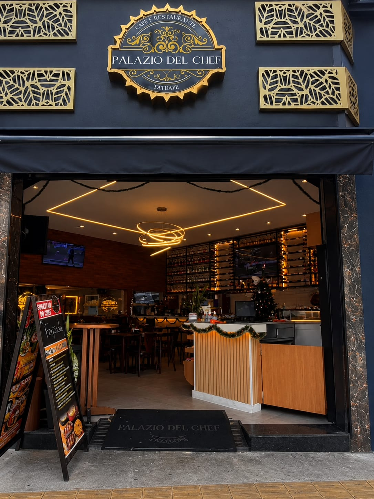
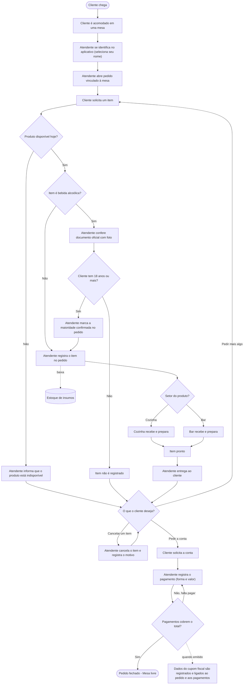
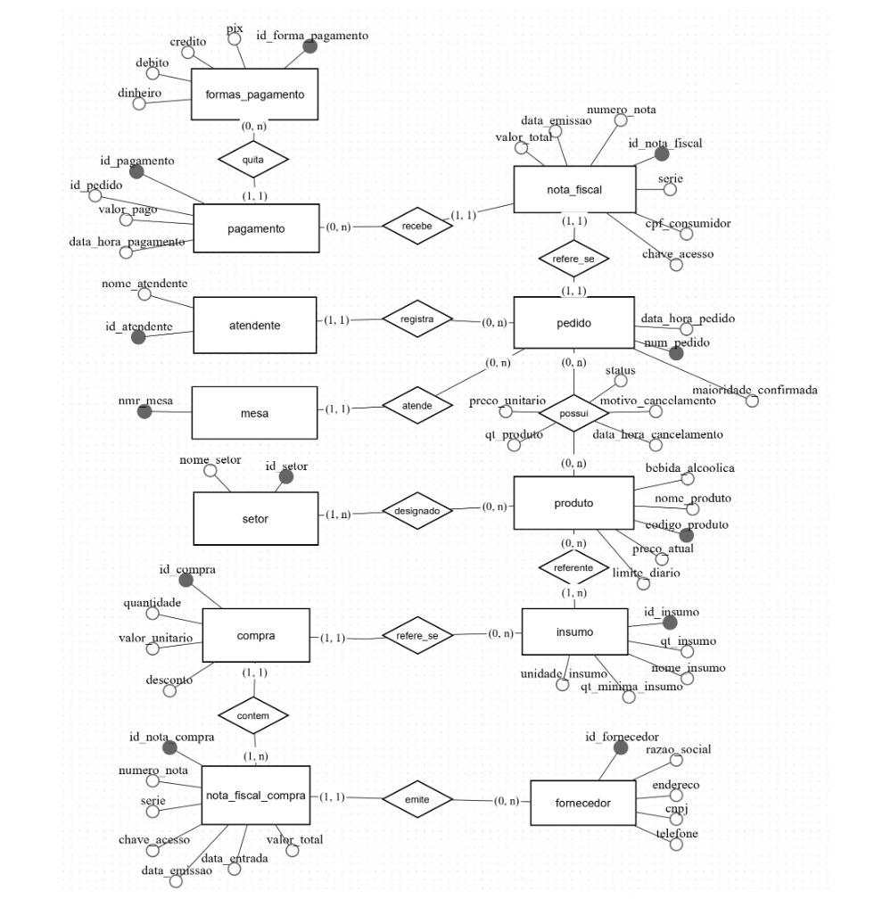
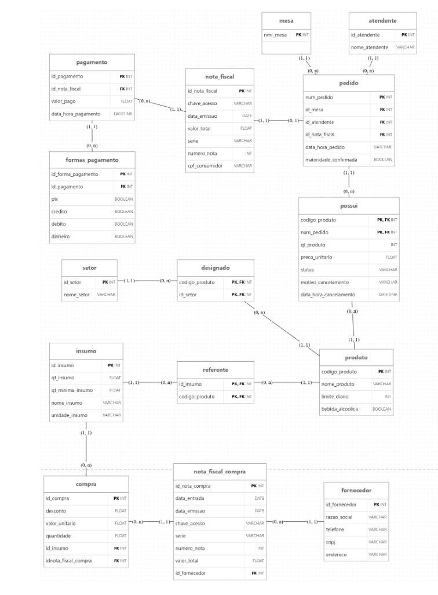
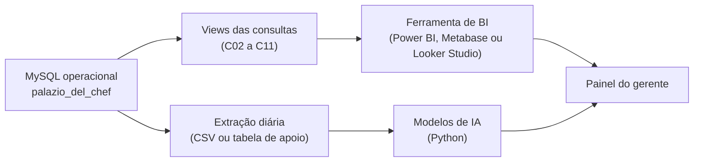

# 🍽️ Projeto: Palazio del Chef

<p align="center">
  
  
</p>

---

## 👥 1. Integrantes

| Integrante | RGM | GitHub |
|---|---|---|
| Raphael Luiz Lima de Araujo | 46995773 | [Raphael186](https://github.com/Raphael186) |
| Ricardo Santos Marcelino | 47023708 | [Ricardo-Sm1](https://github.com/Ricardo-Sm1) |
| Thiago Rodrigues Ribeiro | 47188049 | [thiago-rodrigues-S6](https://github.com/thiago-rodrigues-S6) |
| Victor Sousa dos Anjos | 47333235 | [Victin7](https://github.com/Victin7) |

**Curso / Disciplina:** Análise e Desenvolvimento de Sistemas — Modelagem de Banco de Dados (UNICID) · Prof. Cid Andrade.

---

## Sumário

---

1. [Integrantes](#-1-integrantes)
2. [Contextualização e Visão Geral](#-2-contextualização-e-visão-geral)
3. [Análise e Modelagem](#-3-análise-e-modelagem)
4. [Requisitos e Regras de Negócio](#-4-requisitos-e-regras-de-negócio)
5. [Dicionário de Dados](#-5-dicionário-de-dados)
6. [Diagrama Entidade-Relacionamento](#-6-diagrama-entidade-relacionamento)
7. [Modelo Relacional](#-7-modelo-relacional)
8. [Normalização](#-8-normalização)
9. [Implementação do Banco de Dados](#-9-implementação-do-banco-de-dados)
10. [Consultas SQL](#-10-consultas-sql)
11. [Estrutura do Projeto](#-11-estrutura-do-projeto)
12. [Status do Projeto](#-12-status-do-projeto)
13. [Justificativa Técnica da Modelagem](#-13-justificativa-técnica-da-modelagem)
14. [Uso de Inteligência Artificial](#-14-uso-de-inteligência-artificial)
15. [Contexto Acadêmico](#-15-contexto-acadêmico)

---
---

## 📖 2. Contextualização e Visão Geral


### 2.1 Identificação do estabelecimento

— **Nome do estabelecimento:** Palazio del Chef

— **Razão social:** Bar e Restaurante Palazio Del Chef Tatuape LTDA.

— **CNPJ:** 58759116000199

— **Endereço:** R.Apucarana, 480 - Tatuapé, São Paulo - (CEP 03311-000).

— **Telefone:** (11) 2359-7134

— **Google Maps:** https://acesse.one/PalazioDelChefe

— **Redes sociais oficiais:** https://www.instagram.com/palaziodelchef/?hl=en

— **Porte:** o Palazio del Chef é um bar e restaurante de pequeno porte, com
atendimento presencial. O estabelecimento
conta com 24 funcionários, somando os dois turnos.  volume de 100 a 200 pedidos (comandas)
por dia.

<p align="center">
  
</p>

--- 
### 2.2 Entrevista 


Durante a visita ao restaurante, foi realizada uma entrevista com um gerente do estabelecimento, com o objetivo de compreender seu funcionamento e levantar informações relevantes para o desenvolvimento do projeto de modelagem de banco de dados.

A conversa permitiu identificar características da operação, incluindo o atendimento aos clientes, o registro dos pedidos, o encaminhamento dos pedidos aos setores responsáveis e o gerenciamento do estoque.

Como evidência da visita realizada, apresenta-se a fotografia registrada pela equipe durante o encontro com o gerente do estabelecimento.

<p align="center">
  
</p>

*Figura 2 — Registro fotográfico da equipe durante a visita ao estabelecimento.*

---

### 2.3 Levantamento de requisitos durante a entrevista. 

Durante a entrevista, foram identificadas as seguintes características do funcionamento do restaurante:

- **Modalidade de atendimento:** o restaurante não realiza entregas por delivery.
- **Registro de pedidos:** os funcionários utilizam um aplicativo para registrar os pedidos dos clientes.
- **Encaminhamento dos pedidos:** após o registro no aplicativo, os pedidos são encaminhados à cozinha ou ao bar, conforme o setor responsável por sua preparação.
- **Acesso ao aplicativo:** segundo as informações obtidas, os funcionários não possuem credenciais individuais de acesso.
- **Gerenciamento de compras e estoque:** o proprietário é responsável pelas compras dos produtos destinados ao estoque.

Essas informações servem como base para compreender os processos operacionais do restaurante e orientar a identificação dos requisitos e das regras de negócio considerados no projeto do banco de dados.


---

## 🔍 3. Análise e Modelagem

Esta etapa apresenta a análise do funcionamento do Palazio del Chef, considerando as informações obtidas durante a visita ao estabelecimento e a entrevista realizada com um gerente. A partir desse levantamento, são descritos os principais processos de negócio, a necessidade de organização das informações e a solução proposta por meio da modelagem de um banco de dados relacional.

### 3.1 Caracterização do estabelecimento

O Palazio del Chef é um estabelecimento do segmento de alimentação, com características de restaurante e bar, localizado no bairro do Tatuapé, em São Paulo - SP. Seu funcionamento envolve atividades relacionadas ao atendimento presencial dos clientes, ao registro de pedidos, à preparação de produtos e ao gerenciamento de informações operacionais.

Durante a visita ao estabelecimento, foi realizada uma entrevista com um gerente para compreender aspectos de sua operação. Conforme as informações obtidas, os atendentes utilizam um aplicativo para registrar os pedidos dos clientes. Após o registro, os pedidos são encaminhados à cozinha ou ao bar, de acordo com o setor responsável pela preparação dos produtos.

Em relação ao gerenciamento de estoque, foi informado que o proprietário é responsável pelas compras dos produtos destinados ao abastecimento do estabelecimento. O controle das quantidades é realizado manualmente, por meio de planilhas, anotações ou contagem física, conforme as práticas utilizadas no gerenciamento do estoque.

Também foi informado que os funcionários não possuem credenciais individuais de acesso ao aplicativo utilizado para registrar os pedidos. Essa característica foi considerada no levantamento das informações relevantes para o projeto.

O restaurante realiza atendimento presencial e não oferece serviço de delivery, conforme informado durante a entrevista. Essas características contribuem para delimitar os processos considerados na modelagem e identificar as informações que deverão ser representadas no banco de dados proposto.

### 3.2 Objetivo do projeto

O projeto tem como objetivo desenvolver a modelagem de um banco de dados relacional capaz de organizar e relacionar as principais informações envolvidas nas operações do Palazio del Chef.

A proposta contempla a representação dos dados relacionados aos pedidos, produtos, mesas, atendentes, setores, pagamentos, notas fiscais, estoque de insumos, compras e fornecedores, considerando os processos identificados durante a análise do estabelecimento.

Por meio da definição de entidades, atributos, relacionamentos, cardinalidades e restrições de integridade, busca-se estruturar os dados de maneira consistente, permitindo representar as relações entre os elementos envolvidos nas operações do restaurante.

A modelagem também servirá de base para a construção do modelo relacional e para a futura implementação utilizando MySQL e SQL, conforme as etapas previstas no projeto acadêmico.

### 3.3 Mapeamento dos processos de negócio

O mapeamento dos processos de negócio busca representar as principais atividades realizadas no estabelecimento, identificando as etapas conhecidas, os participantes envolvidos e as informações relacionadas a cada operação.

Com base nas informações levantadas durante a entrevista, foram identificados os seguintes processos:

**a) Atendimento ao cliente**

O atendimento ocorre presencialmente, com os clientes utilizando as mesas do estabelecimento e sendo atendidos pelos atendentes responsáveis. Na modelagem proposta, a associação entre mesas, pedidos e atendentes permitirá representar as informações relacionadas ao atendimento.

**b) Registro do pedido**

Os atendentes utilizam um aplicativo para registrar os pedidos realizados pelos clientes. No banco de dados proposto, esse processo será representado pelas entidades Pedido, Produto, Mesa e Atendente, permitindo relacionar cada pedido à mesa correspondente, identificar o atendente responsável pelo registro e armazenar os produtos solicitados, suas quantidades e seus preços unitários.

Na venda de bebidas alcoólicas, a modelagem propõe que o produto seja identificado como bebida alcoólica (atributo `bebida_alcoolica` da entidade Produto) e que o pedido registre se a maioridade do cliente foi confirmada (atributo `maioridade_confirmada` da entidade Pedido). Pela regra proposta, antes de registrar um item alcoólico, o atendente solicita ao cliente um documento oficial com foto e confere se ele tem 18 anos ou mais. O documento é apenas visualizado e nenhum dado dele é armazenado, em respeito ao princípio da necessidade previsto na LGPD. Esse procedimento é uma hipótese de modelagem, e a forma como o estabelecimento realiza essa conferência ainda deverá ser confirmada com o gerente.

**c) Encaminhamento e preparação dos pedidos**

Após o registro no aplicativo, os pedidos são encaminhados à cozinha ou ao bar, conforme o setor responsável pela preparação dos produtos. Para representar essa característica, a modelagem considera a entidade Setor, relacionada aos produtos de acordo com sua classificação.

O fluxo detalhado de preparação, incluindo a ordem das atividades e os procedimentos utilizados para acompanhar o andamento dos pedidos, ainda deverá ser confirmado com o estabelecimento.

**d) Fechamento da conta e pagamento**

O processo de pagamento pode envolver a divisão da conta entre diferentes pessoas ou a realização de vários pagamentos para quitar uma mesma conta. Essa característica deve ser considerada na modelagem para permitir que um pedido possua mais de um registro de pagamento.

A entidade Pagamento armazenará o valor pago e a data e o horário de cada pagamento, e se relaciona com a entidade Forma_Pagamento, que cadastra de forma padronizada as formas aceitas pelo estabelecimento (como dinheiro, crédito, débito e Pix). A associação entre os pedidos e seus pagamentos permitirá representar a quitação em etapas, conforme as regras definidas para o projeto. Enquanto o cliente não paga, o pedido permanece em aberto, sem nenhum pagamento registrado.

O modelo também prevê a entidade Nota_Fiscal, que armazena os dados do cupom fiscal (número, série, data de emissão, valor total e chave de acesso) e, quando o cliente pede, o CPF do consumidor (campo opcional). Como hipótese de modelagem, considera-se que a emissão é feita por um sistema externo ao banco de dados e que a nota se relaciona ao pedido e aos pagamentos dele. Como o pagamento e a emissão do cupom podem ocorrer em momentos diferentes, o pagamento pode ser registrado antes da nota e ligado a ela depois. Cada pedido possui no máximo uma nota fiscal.

Os procedimentos específicos utilizados pelo restaurante para dividir as contas, registrar os pagamentos e emitir o cupom fiscal, assim como a eventual cobrança de taxa de serviço ou couvert, ainda precisam ser detalhados para que o modelo represente integralmente o processo atual.


**e) Controle de estoque e compras**

O gerenciamento do estoque envolve o acompanhamento das quantidades disponíveis dos insumos utilizados pelo estabelecimento. Conforme informado durante a entrevista, o controle é realizado manualmente, por meio de planilhas, anotações ou contagem física, e o proprietário é responsável pelas compras destinadas ao abastecimento.

Na modelagem proposta, a entidade Insumo representa o que fica em estoque, com a quantidade disponível, a unidade de medida e a quantidade mínima desejada. O modelo não trabalha com receitas: pratos como a feijoada são cadastrados como Produto, e uma bebida como a coca é um produto como qualquer outro. A entidade Insumo existe para dar sentido ao controle de estoque e às compras.

As compras são representadas pelas entidades Fornecedor, Nota_Fiscal_Compra e Compra. Cada nota fiscal de compra é emitida por um fornecedor cadastrado e contém uma ou mais compras, e cada compra se refere a um insumo, com quantidade, valor unitário e desconto opcional. A estrutura deverá considerar a necessidade de organizar essas informações no banco de dados, sem pressupor que o estabelecimento já utiliza um sistema integrado para essa finalidade. A forma como as compras são registradas hoje ainda deverá ser confirmada com o gerente.

**f) Cadastro e controle de atendentes**

O cadastro de atendentes será considerado na modelagem para identificar os atendentes responsáveis pelo registro dos pedidos. A associação entre Pedido e Atendente permitirá relacionar cada pedido ao atendente correspondente, conforme as regras de negócio estabelecidas no projeto.

Durante a entrevista, também foi informado que os funcionários não possuem credenciais individuais de acesso ao aplicativo utilizado no registro dos pedidos. Essa informação deverá ser considerada na análise dos requisitos de identificação e controle de acesso, sem pressupor funcionalidades que ainda não foram confirmadas.

O detalhamento desses processos servirá de base para a construção do fluxograma e para a definição dos requisitos funcionais, das regras de negócio e dos relacionamentos representados no Diagrama Entidade-Relacionamento (DER).

**g) Cadastro de cardápio e preços**

O cardápio do estabelecimento apresenta os produtos comercializados, organizados por categorias e acompanhados de seus respectivos preços. Esse material serve como referência para a identificação dos produtos que poderão ser representados na modelagem do banco de dados.

Na estrutura proposta, a entidade Produto será responsável pelo cadastro das informações dos produtos, incluindo sua identificação e seu preço atual. O preço unitário aplicado a cada produto também será registrado no respectivo item do pedido, permitindo manter o histórico do valor considerado no momento da venda. O cadastro do produto também identifica se ele é uma bebida alcoólica, informação utilizada na regra de conferência de maioridade.

📄 *Documento de referência:* [Consultar cardápio do Palazio del Chef (PDF)](./cardapio_palazio_diurno.pdf)

---

### 3.4 Fluxograma do processo de atendimento

O fluxograma a seguir representa o fluxo de atendimento do Palazio del Chef, desde a chegada do cliente ao estabelecimento até o fechamento da conta e sua saída. O objetivo é apresentar visualmente as principais etapas do processo, incluindo o registro do pedido, o encaminhamento dos produtos aos setores responsáveis pela preparação e a realização do pagamento.

O fluxo foi elaborado com base nas informações levantadas durante a entrevista com o estabelecimento. As etapas operacionais que ainda não foram confirmadas deverão ser validadas para garantir que a representação corresponda ao funcionamento real do restaurante.


*— Fluxo do processo de atendimento, registro de pedidos, preparação e pagamento.*

> **Nota sobre o fluxograma:** o desenho mostra a sequência do atendimento (da chegada do cliente até a mesa ser liberada). Os pontos abaixo são **hipóteses de modelagem da equipe**, e não fatos confirmados pelo gerente:
>
> - **Identificação do atendente:** o gerente informou que os funcionários não têm login individual no aplicativo. Por isso, o atendente se identifica escolhendo seu nome na tela, e não entrando com usuário e senha.
> - **Baixa no estoque (seta pontilhada):** o gerente informou que o estoque é controlado manualmente (planilha, anotação ou contagem). A baixa automática a cada item pedido é uma proposta nossa para o sistema. 
> - **Conferência de maioridade:** o gerente não informou como a idade é conferida na venda de bebida alcoólica. O fluxo representa a decisão do grupo (conferência de documento sem armazenar dados) e será validado na segunda entrevista.
> - **Cancelamento de item e pagamento:** o cancelamento de item, a divisão da conta em vários pagamentos e o registro do cupom fiscal (emitido por sistema externo, seta pontilhada) também são hipóteses a validar.
> - **Produto indisponível:** o limite diário de porções por produto é uma proposta do grupo (não foi informada pelo gerente). Quando o limite do dia é atingido, o produto fica indisponível para novos pedidos.

---

### 3.5 Identificação do problema

A análise dos processos operacionais do Palazio del Chef permitiu identificar necessidades relacionadas à organização, ao armazenamento e à consulta das informações utilizadas no funcionamento do estabelecimento.

Considerando as características de um restaurante de pequeno porte, com equipe reduzida e dois gerentes responsáveis pela alternância entre os turnos diurno e noturno, foram identificados os seguintes pontos de atenção:

| Código | Problema identificado |
|---|---|
| PN01 | Ausência de identificação individual dos funcionários no aplicativo utilizado para registrar os pedidos, dificultando a identificação dos responsáveis por cada operação. |
| PN02 | Controle manual do estoque, dificultando a centralização das informações sobre as quantidades disponíveis e a consulta dos registros de movimentação dos insumos. |
| PN03 | Necessidade de registrar entradas, saídas, perdas e ajustes de estoque, permitindo identificar as alterações realizadas nas quantidades dos insumos. |
| PN04 | Necessidade de organizar a passagem de informações entre os gerentes, permitindo consultar pendências, pedidos em aberto e ocorrências registradas nos turnos anteriores. |
| PN05 | Ausência de uma estrutura definida na modelagem atual para acompanhar as etapas de preparação dos pedidos, desde o encaminhamento à cozinha ou ao bar até a entrega ao cliente. |
| PN06 | Necessidade de organizar as informações financeiras por turno, permitindo consultar pagamentos recebidos, formas de pagamento utilizadas e valores registrados em cada período. |
| PN07 | Necessidade de manter um histórico das alterações e dos cancelamentos realizados nos pedidos, identificando os responsáveis, os horários e as respectivas justificativas. |
| PN08 | Necessidade de controlar a disponibilidade dos produtos comercializados, permitindo identificar itens temporariamente indisponíveis e limites diários de comercialização. |
| PN09 | Necessidade de manter um histórico das alterações de preços dos produtos, possibilitando consultar os valores praticados em diferentes períodos. |

---

### 3.6 Solução proposta

Como solução para os pontos identificados, propõe-se desenvolver um banco de dados relacional utilizando MySQL, com o objetivo de centralizar e organizar as informações relacionadas às operações do Palazio del Chef.

A estrutura proposta deverá considerar a realidade de um restaurante de pequeno porte, priorizando funcionalidades simples, integridade dos dados e facilidade de consulta.

As soluções propostas são:

| Código | Solução proposta |
|---|---|
| SP01 | Estruturar o cadastro de atendentes e relacionar cada pedido ao funcionário responsável pelo seu registro, permitindo identificar os responsáveis pelas operações. |
| SP02 | Centralizar as informações dos insumos em uma estrutura relacional, armazenando quantidades disponíveis, unidades de medida e quantidades mínimas para reposição. |
| SP03 | Criar uma estrutura de movimentação de estoque para registrar entradas, saídas, perdas e ajustes, identificando a data, a quantidade e o responsável pela operação. |
| SP04 | Implementar o controle de turnos, relacionando cada período ao gerente responsável e permitindo registrar observações e pendências para consulta pelo próximo gerente. |
| SP05 | Implementar o acompanhamento do status de preparação dos itens dos pedidos, permitindo identificar produtos recebidos, em preparo, prontos, entregues ou cancelados. |
| SP06 | Relacionar os pagamentos aos respectivos turnos, permitindo consultar os valores recebidos por período e por forma de pagamento, além de registrar conferências financeiras. |
| SP07 | Implementar o registro histórico de alterações e cancelamentos dos pedidos, armazenando o tipo de alteração, a data, o responsável e a justificativa. |
| SP08 | Implementar o controle de disponibilidade dos produtos, permitindo registrar a situação de comercialização e os limites diários definidos para determinados itens. |
| SP09 | Criar uma estrutura de histórico de preços, permitindo registrar os valores anteriores e atuais dos produtos, juntamente com a data e o responsável pela alteração. |

---

## ⚙️ 4. Requisitos e Regras de Negócio

Esta seção apresenta os requisitos funcionais e não funcionais e as regras de negócio consideradas no desenvolvimento do banco de dados do Palazio del Chef. Sua definição tem como base as informações levantadas durante a entrevista com um gerente do estabelecimento e as entidades e os relacionamentos representados no Diagrama Entidade-Relacionamento (DER).


## 4.1 Requisitos Funcionais

Os requisitos funcionais descrevem as operações que o sistema deverá permitir para apoiar o funcionamento do restaurante.

| Código | Requisito funcional |
| :--- | :--- |
| RF01 | O sistema deve permitir o registro de pedidos, associando cada pedido a uma mesa e ao atendente responsável. |
| RF02 | O sistema deve permitir a inclusão de produtos em um pedido, informando a quantidade e o preço unitário considerado para cada produto. |
| RF03 | O sistema deve permitir o cadastro e a consulta dos produtos disponíveis, incluindo nome, código, preço atual, limite diário de porções (opcional) e a indicação de bebida alcoólica. |
| RF04 | O sistema deve permitir o cadastro e a identificação das mesas utilizadas no atendimento. |
| RF05 | O sistema deve permitir o cadastro dos atendentes responsáveis pelo registro dos pedidos. |
| RF06 | O sistema deve permitir a classificação dos produtos conforme o setor responsável por sua preparação, como cozinha ou bar. |
| RF07 | O sistema deve permitir o registro de um ou mais pagamentos para cada pedido (divisão da conta), incluindo data e hora, valor pago e a forma de pagamento escolhida entre as formas cadastradas. |
| RF08 | O sistema deve permitir o registro e a consulta dos insumos em estoque, com a quantidade disponível, a unidade de medida e a quantidade mínima. |
| RF09 | O sistema deve permitir o cancelamento de itens de um pedido, registrando o motivo e a data e hora do cancelamento, sem excluir o item. |
| RF10 | O sistema deve permitir o registro dos dados da nota fiscal emitida para um pedido, incluindo o CPF do consumidor quando ele for informado, e a ligação da nota aos pagamentos desse pedido. |
| RF11 | O sistema deve permitir registrar a confirmação de maioridade do cliente no pedido, antes do registro de itens de bebida alcoólica. |
| RF12 | O sistema deve permitir o cadastro dos fornecedores, com razão social, CNPJ, endereço e telefone. |
| RF13 | O sistema deve permitir o registro das notas fiscais de compra emitidas pelos fornecedores e das compras de insumos que fazem parte de cada nota, informando quantidade, valor unitário e desconto. |
| RF14 | O sistema deve permitir identificar os insumos cuja quantidade em estoque está abaixo da quantidade mínima. |

### 4.2 Requisitos Não Funcionais

Os requisitos não funcionais estabelecem condições de segurança, integridade e confiabilidade para o funcionamento do sistema.

| Código | Requisito não funcional |
| :--- | :--- |
| RNF01 | O sistema deve preservar a integridade referencial dos dados por meio de chaves primárias e estrangeiras, impedindo associações inválidas entre registros. |
| RNF02 | O sistema deve garantir que os dados obrigatórios de pedidos, produtos, mesas e pagamentos sejam validados antes de sua gravação, conforme as restrições definidas no modelo. |
| RNF03 | O sistema deverá prever mecanismos de controle de acesso para restringir operações e informações conforme as permissões dos usuários autorizados. Trata-se de proposta do grupo: segundo a entrevista, os funcionários não possuem atualmente credenciais individuais de acesso ao aplicativo. |
| RNF04 | O sistema deve armazenar os valores monetários em tipos de dados apropriados para evitar perda indevida de precisão nos preços e pagamentos. |

### 4.3 Regras de Negócio

As regras de negócio definem condições que devem ser respeitadas para representar corretamente as operações do restaurante e manter a consistência das informações armazenadas.

| Código | Regra | Descrição |
| :--- | :--- | :--- |
| RN01 | Rastreabilidade dos pedidos | Todo pedido registrado deve estar associado a exatamente um atendente responsável pelo seu registro. |
| RN02 | Vinculação à mesa | Todo pedido deve estar associado a exatamente uma mesa, conforme o modelo de atendimento presencial considerado no projeto. |
| RN03 | Identificação dos produtos | Cada produto cadastrado deve possuir um código identificador único (`codigo_produto`), utilizado para diferenciá-lo dos demais produtos registrados no sistema. |
| RN04 | Composição dos pedidos | Um pedido pode conter um ou mais produtos, e um mesmo produto pode estar presente em diferentes pedidos. A quantidade e o preço unitário devem ser registrados para cada associação entre pedido e produto. |
| RN05 | Encaminhamento por setor | Cada produto deve estar associado ao setor responsável por sua preparação, como cozinha ou bar, de acordo com a classificação definida no cadastro. |
| RN06 | Registro de pagamentos | Um pedido pode não possuir pagamentos registrados, possuir um único pagamento ou possuir vários pagamentos, permitindo que o valor seja quitado em etapas. Enquanto o cliente não pagar, o pedido permanece em aberto, sem nenhum pagamento registrado. |
| RN07 | Controle de estoque | O estoque é controlado por insumo, e cada insumo possui quantidade disponível, unidade de medida e quantidade mínima. |
| RN08 | Integridade dos registros | Os registros relacionados entre si devem respeitar as chaves e as restrições de integridade definidas no banco de dados, evitando referências a registros inexistentes. |
| RN09 | Validação de quantidades e valores | A quantidade de produtos em um pedido deve ser maior que zero. Os atributos `preco_unitario` e `preco_atual` não podem assumir valores negativos, e `valor_pago` deve ser maior que zero. Os atributos `qt_produto`, `preco_unitario`, `preco_atual` e `valor_pago` são obrigatórios. |
| RN10 | Associação de produtos aos setores | Cada produto deve possuir um setor responsável definido no cadastro, conforme a estrutura representada no DER. |
| RN11 | Identificação e data dos pedidos | Cada pedido deve possuir um identificador próprio e uma data e hora de registro, permitindo sua diferenciação e consulta posterior. |
| RN12 | Identificação dos pagamentos | Cada registro de pagamento deve possuir um identificador próprio, possibilitando sua identificação individual no sistema. |
| RN13 | Disponibilidade em estoque | O atributo `qt_insumo` é obrigatório e seu valor não pode ser negativo. Quando não houver unidades disponíveis, o valor deve ser zero. |
| RN14 | Data e hora do pagamento | O atributo `data_hora_pagamento` é obrigatório e registra o momento em que o pagamento foi realizado. Um pagamento só é registrado depois de realizado. |
| RN15 | Produto indisponível | Produto com limite diário não pode ser pedido além do limite no dia. |
| RN16 | Cancelamento de item | O item só pode ser cancelado enquanto o setor não iniciou o preparo. |
| RN17 | Registro do cancelamento | Item cancelado não é excluído; fica registrado com motivo e não conta no limite. |
| RN18 | Bebidas alcoólicas | Produtos cadastrados como bebida alcoólica só podem ser vendidos a pessoas maiores de 18 anos. |
| RN19 | Conferência da idade | Antes de registrar um item alcoólico, o atendente deve conferir a maioridade do cliente por meio de documento oficial com foto. Nenhum dado do documento (nome, RG, CPF ou data de nascimento) é registrado no sistema. |
| RN20 | Quitação do pedido | A soma dos pagamentos de um pedido não pode ultrapassar o valor total do pedido, calculado pela soma de `qt_produto` × `preco_unitario` dos itens não cancelados. O pedido é considerado quitado quando a soma dos pagamentos é igual a esse valor. |
| RN21 | Forma de pagamento | Todo pagamento deve utilizar uma forma de pagamento previamente cadastrada (como dinheiro, crédito, débito ou Pix). |
| RN22 | Nota fiscal | Cada pedido possui no máximo uma nota fiscal, que pode ser ligada aos pagamentos desse pedido. O pagamento não depende da nota: ele pode ser registrado antes, e a nota é ligada a ele depois (hipótese de modelagem, a confirmar na segunda entrevista). |
| RN23 | Confirmação de maioridade | Um item de bebida alcoólica só pode ser registrado em um pedido cujo campo `maioridade_confirmada` esteja preenchido como confirmado. |
| RN24 | Estoque mínimo | Quando a quantidade disponível de um insumo (`qt_insumo`) ficar abaixo da quantidade mínima (`qt_minima_insumo`), o insumo deve ser sinalizado para reposição. A quantidade mínima é obrigatória e não pode ser negativa. |
| RN25 | Compra de fornecedor cadastrado | Toda nota fiscal de compra deve estar associada a um fornecedor previamente cadastrado. |
| RN26 | Composição da compra | Cada compra se refere a um único insumo e pertence a uma única nota fiscal de compra, e uma nota contém uma ou mais compras. Em cada compra, `quantidade` deve ser maior que zero, `valor_unitario` não pode ser negativo e `desconto`, que é opcional, não pode ser negativo nem maior que `quantidade` × `valor_unitario`. |
| RN27 | Nota fiscal de compra | Os atributos `numero_nota`, `serie`, `chave_acesso`, `data_emissao`, `data_entrada` e `valor_total` são obrigatórios. A `chave_acesso` deve ser única, o `valor_total` deve ser maior que zero e a `data_entrada` não pode ser anterior à `data_emissao`. |
| RN28 | CPF na nota | O CPF do consumidor (`cpf_consumidor`) é opcional e só é registrado quando o cliente pede. Se o cliente não quiser o CPF na nota, a venda segue normalmente. |
| RN29 | Pagamento e nota do mesmo pedido | Um pagamento só pode ser ligado à nota fiscal do próprio pedido. |

--- 

### 4.4 Relação com a Modelagem do Banco de Dados

Os requisitos e as regras apresentados orientam a estruturação das entidades, dos atributos e dos relacionamentos do banco de dados. As regras referentes aos pedidos, produtos, mesas, atendentes, setores, insumos, pagamentos, formas de pagamento, notas fiscais, fornecedores, compras e notas fiscais de compra devem ser implementadas por meio de chaves, restrições e validações adequadas no modelo relacional.

As regras que dependem de decisões operacionais ainda não confirmadas deverão ser validadas com o estabelecimento antes da implementação definitiva do sistema.

---

## 🗄️ 5. Dicionário de Dados

O mapeamento das variáveis do sistema foi estruturado e documentado internamente com base nos parâmetros estabelecidos no portal *Datapsico*.

O modelo de banco de dados relacional é composto pelas seguintes entidades principais:

- **Atendente**
- **Mesa**
- **Pedido**
- **Produto**
- **Setor**
- **Insumo**
- **Pagamento**
- **Forma_Pagamento**
- **Nota_Fiscal**
- **Fornecedor**
- **Compra**
- **Nota_Fiscal_Compra**

Cada entidade possui atributos específicos, identificadores e relacionamentos definidos de acordo com as necessidades levantadas durante a análise do estabelecimento.

Os atributos são tipados de acordo com suas características, utilizando tipos como `Integer`, `Varchar`, `Date` e `Decimal`.

O modelo utiliza **Chaves Primárias (PK)** e **Chaves Estrangeiras (FK)** para estabelecer os relacionamentos e garantir a integridade dos dados.

> 📌 O dicionário de dados completo será disponibilizado na documentação do projeto.

[Ver Dicionario](./dicionario_dados_palazio/)

---

## 🔗 6. Diagrama Entidade-Relacionamento

O **Diagrama Entidade-Relacionamento (DER)** representa graficamente as entidades, atributos, relacionamentos e cardinalidades identificados durante a etapa de modelagem.

### 📊 Diagrama

<p align="center">
  
</p>

> [Ver Diagrama](./Diagrama_Palazio_del_Chef/).

---

## 🧩 7. Modelo Relacional

O modelo conceitual (seção 6) foi convertido em **13 tabelas**, implementadas em MySQL 8.0 no arquivo [`banco-de-dados-palazio2.sql`](./banco-de-dados-palazio2.sql). A imagem abaixo mostra as tabelas, as chaves primárias (PK) e as chaves estrangeiras (FK).

<p align="center">
  
</p>

> [Ver Modelo](./modelo_relacional/).

### 7.1 Do modelo conceitual ao relacional

| Elemento do DER | Regra de conversão | Resultado no banco |
| :--- | :--- | :--- |
| Entidade | Vira uma tabela; o identificador vira chave primária | `pedido` (`num_pedido`), `produto` (`codigo_produto`), `mesa` (`nmr_mesa`), `atendente`, `setor`, `forma_pagamento`, `insumo`, `fornecedor` |
| Relacionamento N:N (o pedido contém produtos) | Vira uma tabela associativa, que guarda os atributos do relacionamento | `item_pedido`, com PK composta (`num_pedido`, `codigo_produto`) e os campos `qt_produto`, `preco_unitario`, `status`, `motivo_cancelamento` e `data_hora_cancelamento` |
| Relacionamento 1:N | A chave do lado 1 vira chave estrangeira no lado N | `pedido.id_atendente`, `pedido.nmr_mesa`, `produto.id_setor`, `produto.id_insumo`, `pagamento.num_pedido`, `pagamento.id_forma_pagamento`, `compra.id_insumo`, `compra.id_nota_compra` |
| Relacionamento 1:0..1 (um pedido tem no máximo uma nota fiscal) | Chave estrangeira com restrição `UNIQUE` | `nota_fiscal.num_pedido` é `UNIQUE` |
| Atributo que não pode repetir | `UNIQUE` | `fornecedor.cnpj` e `nota_fiscal.chave_acesso` |
| Regra de domínio | `CHECK` | 14 restrições: valores positivos, CNPJ com 14 dígitos, CPF com 11, desconto limitado ao valor da compra, entre outras |

### 7.2 Chaves estrangeiras

| Tabela filha | Coluna | Tabela pai |
| :--- | :--- | :--- |
| `pedido` | `id_atendente` | `atendente` |
| `pedido` | `nmr_mesa` | `mesa` |
| `item_pedido` | `num_pedido` | `pedido` |
| `item_pedido` | `codigo_produto` | `produto` |
| `produto` | `id_setor` | `setor` |
| `produto` | `id_insumo` | `insumo` |
| `pagamento` | `num_pedido` | `pedido` |
| `pagamento` | `id_forma_pagamento` | `forma_pagamento` |
| `pagamento` | `id_nota_fiscal` | `nota_fiscal` |
| `nota_fiscal` | `num_pedido` | `pedido` |
| `compra` | `id_insumo` | `insumo` |
| `compra` | `id_nota_compra` | `nota_fiscal_compra` |
| `nota_fiscal_compra` | `id_fornecedor` | `fornecedor` |

Todas as chaves estrangeiras usam a ação padrão `NO ACTION`: o banco **não deixa apagar** um registro que ainda tem registros ligados a ele (exemplo no item D04 da seção 10.3).
---

## 🧹 8. Normalização

A análise foi feita sobre o modelo implementado em [`banco-de-dados-palazio2.sql`](./banco-de-dados-palazio2.sql) (13 tabelas). O critério adotado foi:

| Forma normal | Condição verificada |
| :--- | :--- |
| **1FN** | Todos os atributos são atômicos, não há grupos repetidos e cada tabela tem chave primária. |
| **2FN** | Está na 1FN e nenhum atributo depende apenas de **parte** de uma chave primária composta. |
| **3FN** | Está na 2FN e nenhum atributo não chave depende de outro atributo não chave (sem dependência transitiva). |

### 8.1 Do registro de pedido às tabelas finais

Ponto de partida: a comanda como o restaurante a registra, com tudo em um único registro.

**Forma não normalizada (0FN)**

```text
PEDIDO_COMANDA (num_pedido, data_hora_pedido, maioridade_confirmada,
                nmr_mesa, id_atendente, nome_atendente,
                { codigo_produto, nome_produto, nome_setor, preco_unitario, qt_produto, status },
                { forma_pagamento, valor_pago, data_hora_pagamento })
```

As chaves `{ ... }` indicam grupos que se repetem dentro do mesmo pedido.

**1FN: retirar os grupos repetidos e garantir valores atômicos.** Um pedido tem vários produtos e vários pagamentos, então cada grupo vira uma tabela própria, com uma linha por ocorrência e chave primária:

- `pedido (num_pedido, data_hora_pedido, maioridade_confirmada, nmr_mesa, id_atendente, nome_atendente)`
- `item_pedido (num_pedido, codigo_produto, nome_produto, nome_setor, preco_unitario, qt_produto, status)`, chave composta `(num_pedido, codigo_produto)`
- `pagamento (id_pagamento, num_pedido, forma_pagamento, valor_pago, data_hora_pagamento)`

O mesmo raciocínio vale para a compra de insumos: uma nota de compra tem vários insumos, que ficam na tabela `compra`, e o cabeçalho fica em `nota_fiscal_compra`. A seção 8.1.1 mostra onde cada ponto aparece no projeto.

**2FN: eliminar dependência parcial.** Em `item_pedido`, `nome_produto` e `nome_setor` dependem só de `codigo_produto`, e não da chave inteira `(num_pedido, codigo_produto)`. Eles saem para a tabela `produto`. Ficam em `item_pedido` apenas `qt_produto`, `preco_unitario` e `status`, que dependem do par pedido + produto (o preço cobrado naquele pedido, RN04).

**3FN: eliminar dependência transitiva.** Cada atributo que descreve outra entidade vai para a sua própria tabela:

| Dependência transitiva encontrada | Tabela criada |
| :--- | :--- |
| `num_pedido → id_atendente → nome_atendente` | `atendente` |
| `codigo_produto → id_setor → nome_setor` | `setor` |
| `id_pagamento → id_forma_pagamento → descricao` | `forma_pagamento` |
| `num_pedido → nmr_mesa` (a mesa é uma entidade com número próprio) | `mesa` |
| `id_nota_compra → id_fornecedor → razao_social, cnpj, endereco, telefone` | `fornecedor` |
| `compra → id_insumo → nome_insumo, unidade, estoque` | `insumo` |

O total do pedido **não** é guardado em `pedido`: ele é calculado por `SUM(qt_produto * preco_unitario)` dos itens ativos (consulta C02), evitando um valor que poderia ficar diferente dos itens.

### 8.1.1 Onde a 1FN foi aplicada no projeto

| Regra da 1FN | Onde foi aplicada | Evidência no repositório |
| :--- | :--- | :--- |
| Sem grupos repetidos: itens do pedido | `item_pedido`, uma linha por produto, chave composta `(num_pedido, codigo_produto)` | [`banco-de-dados-palazio2.sql`](./banco-de-dados-palazio2.sql), linhas 167 a 181 (chave na linha 175). Nos dados (INSERT da linha 190), o pedido 1 ocupa 3 linhas (produtos 4, 49 e 175) e o pedido 2 ocupa 2. A consulta C02 (`consultas_palazio.sql`, linha 20) soma essas linhas com `GROUP BY`. |
| Sem grupos repetidos: pagamentos | `pagamento`, uma linha por pagamento, chave `id_pagamento` | Linhas 295 a 311. Nos dados (INSERT da linha 320), o pedido 2 foi pago em duas formas (pagamentos 2 e 3) e o pedido 3 também (pagamentos 4 e 5). |
| Sem grupos repetidos: compras de insumos | `nota_fiscal_compra` (cabeçalho) e `compra` (um insumo por linha) | Linhas 260 a 275 e 49 a 64. No INSERT da linha 73, a nota de compra 1 aparece em várias linhas de `compra`. |
| Sem colunas repetidas | Não existem colunas como `produto1`, `produto2` ou `forma_pagamento2`. O que se repete virou linha. | Todas as tabelas do script (linhas 25 a 401). |
| Atributos atômicos | Cada coluna guarda um único valor: data e hora em uma só coluna (`data_hora_pedido`, linha 333), `cnpj` com 14 caracteres (`CHECK`, linha 117), `chave_acesso` com um valor (linha 231) e `cpf_consumidor` com `CHECK` de 11 caracteres (linha 238). | Linhas citadas |
| Atributos atômicos: forma de pagamento | `forma_pagamento` é uma tabela própria, então o pagamento aponta para uma forma por linha, e não para um texto com lista como "dinheiro, pix". | Linhas 84 a 89 e 298 |
| Chave primária em toda tabela | As 13 tabelas têm chave primária. | `atendente` (28), `compra` (56), `forma_pagamento` (87), `fornecedor` (115), `insumo` (144), `item_pedido` (175, composta), `mesa` (203), `nota_fiscal` (233), `nota_fiscal_compra` (269), `pagamento` (302), `pedido` (337), `produto` (370), `setor` (400) |

Pontos que seguem atômicos apenas em parte, já tratados em 8.4: `fornecedor.endereco` (linha 113) é um texto único e `fornecedor.telefone` (linha 114) guarda um único número.

### 8.2 Verificação tabela por tabela

| Tabela | Chave primária | Principais dependências funcionais | 1FN | 2FN | 3FN |
| :--- | :--- | :--- | :---: | :---: | :---: |
| `setor` | `id_setor` | `id_setor → nome_setor` | ✅ | ✅ | ✅ |
| `atendente` | `id_atendente` | `id_atendente → nome_atendente` | ✅ | ✅ | ✅ |
| `mesa` | `nmr_mesa` | só a chave | ✅ | ✅ | ✅ |
| `forma_pagamento` | `id_forma_pagamento` | `id_forma_pagamento → descricao` | ✅ | ✅ | ✅ |
| `insumo` | `id_insumo` | `id_insumo → nome_insumo, qt_insumo, unidade_insumo, qt_minima_insumo` | ✅ | ✅ | ✅ |
| `fornecedor` | `id_fornecedor` | `id_fornecedor → razao_social, cnpj, endereco, telefone` (`cnpj` é único) | ✅ | ✅ | ✅ |
| `produto` | `codigo_produto` | `codigo_produto → nome_produto, preco_atual, limite_diario, bebida_alcoolica, id_setor, id_insumo` | ✅ | ✅ | ✅ |
| `pedido` | `num_pedido` | `num_pedido → data_hora_pedido, maioridade_confirmada, id_atendente, nmr_mesa` | ✅ | ✅ | ✅ |
| `item_pedido` | `(num_pedido, codigo_produto)` | `(num_pedido, codigo_produto) → qt_produto, preco_unitario, status, motivo_cancelamento, data_hora_cancelamento` | ✅ | ✅ | ✅ |
| `pagamento` | `id_pagamento` | `id_pagamento → num_pedido, id_forma_pagamento, id_nota_fiscal, data_hora_pagamento, valor_pago` | ✅ | ✅ | ✅ (ver 8.3) |
| `nota_fiscal` | `id_nota_fiscal` | `id_nota_fiscal → num_pedido, numero_nota, serie, data_emissao, valor_total, chave_acesso, cpf_consumidor` (`num_pedido` e `chave_acesso` são únicos) | ✅ | ✅ | ✅ (ver 8.3) |
| `nota_fiscal_compra` | `id_nota_compra` | `id_nota_compra → id_fornecedor, numero_nota, serie, chave_acesso, data_emissao, data_entrada, valor_total` | ✅ | ✅ | ✅ (ver 8.3) |
| `compra` | `id_compra` | `id_compra → id_insumo, id_nota_compra, quantidade, valor_unitario, desconto` | ✅ | ✅ | ✅ |

Nas tabelas com chave simples a 2FN é satisfeita automaticamente. A única chave composta é a de `item_pedido`, e todos os seus atributos dependem do par completo.

### 8.3 Redundâncias mantidas de propósito

Algumas informações aparecem mais de uma vez por decisão de negócio, e não por falha de normalização. Cada uma tem uma consulta de auditoria que confere a coerência (seção 10.2):

| Redundância | Por que foi mantida | Conferência |
| :--- | :--- | :--- |
| `item_pedido.preco_unitario` repete `produto.preco_atual` | O preço cobrado fica congelado no pedido; se o cardápio mudar, os pedidos antigos não mudam (RN04). | A06 |
| `nota_fiscal.valor_total` pode ser calculado pelos itens do pedido | É o valor impresso no documento fiscal e não pode mudar depois da emissão. | A03 |
| `nota_fiscal_compra.valor_total` pode ser calculado pelas compras | É o valor do documento do fornecedor. | A07 |
| `pagamento.num_pedido` e `pagamento.id_nota_fiscal`: a nota já informa o pedido (`id_nota_fiscal → num_pedido`), uma dependência transitiva possível | A nota é opcional no momento do pagamento (RN22: o pagamento pode ser registrado antes da nota), então o pedido precisa estar no próprio pagamento. A RN29 exige que os dois apontem para o mesmo pedido. | A04 |

### 8.4 Pontos de atenção e possíveis melhorias

- **`fornecedor.endereco`** é um texto único. Se o grupo precisar de consultas por cidade ou bairro, o endereço deve ser dividido em atributos (logradouro, número, bairro, cidade), o que manteria a 1FN com atributos mais atômicos.
- **`produto.id_insumo`** liga cada produto a no máximo um insumo (25 dos 266 produtos têm insumo). Se um prato usar vários insumos, será necessária uma tabela de ligação `produto_insumo` (ficha técnica), que não faz parte do escopo atual.
- **`item_pedido.status`** é um texto livre (`ativo` ou `cancelado`). Um `CHECK` ou uma tabela de domínio garantiria os valores permitidos.

**Conclusão:** todas as 13 tabelas estão na **3FN**. As redundâncias da seção 8.3 são deliberadas, documentadas e conferidas por consultas de auditoria.

**Status:** ✅ Concluído

---

## 🗃️ 9. Implementação do Banco de Dados

O banco foi implementado em **MySQL 8.0** (testado na versão 8.0.46; o dump foi gerado no MySQL 8.4). O nome do banco é `palazio_del_chef`.

### 9.1 Scripts do projeto

| Arquivo | O que faz |
| :--- | :--- |
| [`banco-de-dados-palazio2.sql`](./banco-de-dados-palazio2.sql) | Cria as 13 tabelas, as chaves primárias e estrangeiras e as restrições `CHECK`, e insere a massa de dados |
| [`consultas_palazio.sql`](./consultas_palazio.sql) | 12 consultas de negócio e 7 auditorias (seção 10) |
| [`update_delete_palazio.sql`](./update_delete_palazio.sql) | 4 `UPDATE` e 3 `DELETE`, mais uma demonstração de integridade (seção 10.3) |

### 9.2 Massa de dados

Os dados são **fictícios** e foram montados para simular uma semana de operação, de 01/11/2026 a 08/11/2026.

| Tabela | Registros | Tabela | Registros |
| :--- | ---: | :--- | ---: |
| `pedido` | 50 | `produto` | 266 |
| `item_pedido` | 185 | `insumo` | 42 |
| `pagamento` | 63 | `compra` | 75 |
| `nota_fiscal` | 33 | `nota_fiscal_compra` | 17 |
| `atendente` | 5 | `fornecedor` | 5 |
| `mesa` | 20 | `forma_pagamento` | 4 |
| `setor` | 2 | | |

### 9.3 Como executar

O arquivo `banco-de-dados-palazio2.sql` **não cria o banco**, então o primeiro passo é criá-lo.

**Pelo MySQL Workbench**

1. Abra a conexão **Local instance MySQL80**.
2. Em uma aba nova, execute `CREATE DATABASE IF NOT EXISTS palazio_del_chef;`.
3. Vá em **File > Open SQL Script**, abra `banco-de-dados-palazio2.sql`, escreva `USE palazio_del_chef;` na primeira linha e execute tudo com **Ctrl+Shift+Enter**.
4. Confira com `SELECT COUNT(*) FROM palazio_del_chef.pedido;`, que deve retornar **50**.
5. Abra `consultas_palazio.sql` (ou `update_delete_palazio.sql`) e execute com **Ctrl+Shift+Enter**. Os resultados aparecem em abas na parte de baixo.

**Pelo terminal (cmd)**

```bash
mysql -u root -p --default-character-set=utf8mb4 -e "CREATE DATABASE IF NOT EXISTS palazio_del_chef"
mysql -u root -p --default-character-set=utf8mb4 palazio_del_chef < banco-de-dados-palazio2.sql
mysql -u root -p --default-character-set=utf8mb4 -t < consultas_palazio.sql
mysql -u root -p --default-character-set=utf8mb4 -t < update_delete_palazio.sql
```

> No PowerShell o símbolo `<` não funciona; use o `cmd` ou o Workbench. Se o seu banco de testes tiver outro nome, troque também a linha `USE palazio_del_chef;` no início dos arquivos de consultas.

### 🛠️ Tecnologias e Ferramentas

- **SGBD:** MySQL 8.0
- **Linguagem:** SQL
- **Ferramentas:** MySQL Workbench e BRModelo
- **Versionamento:** Git e GitHub

**Status:** ✅ Concluído

---

## 📋 10. Consultas SQL

As consultas foram escritas sobre o banco `palazio_del_chef` (arquivo [`banco-de-dados-palazio2.sql`](./banco-de-dados-palazio2.sql), MySQL 8.0, 13 tabelas e 50 pedidos de 01/11 a 08/11/2026) e estão reunidas em [`consultas_palazio.sql`](./consultas_palazio.sql). Todas foram executadas no MySQL 8.0.46 a partir do banco recém-importado, sem erros. Os resultados abaixo são a saída real dessa execução.

**Como executar**

```bash
mysql -u root -p --default-character-set=utf8mb4 -e "CREATE DATABASE IF NOT EXISTS palazio_del_chef"
mysql -u root -p --default-character-set=utf8mb4 palazio_del_chef < banco-de-dados-palazio2.sql
mysql -u root -p --default-character-set=utf8mb4 -t < consultas_palazio.sql
```

Recursos de SQL usados: `JOIN` (até 4 tabelas), `LEFT JOIN`, `GROUP BY` com `HAVING`, funções de agregação (`SUM`, `COUNT`, `AVG`, `ROUND`), função de janela (`SUM() OVER ()`), subconsultas em `FROM`, `NOT EXISTS` e subconsulta correlacionada.

### 10.1 Consultas de negócio

| Código | Pergunta | Regras |
| :--- | :--- | :--- |
| C01 | Comanda do pedido 2: o que foi pedido, por quem e em qual mesa (JOIN em 4 tabelas) | RN01, RN02, RN04 |
| C02 | Valor total de cada pedido, sem os itens cancelados (agregação) | RN20 |
| C03 | Faturamento por atendente: pedidos, ticket médio e total vendido | RN01 |
| C04 | Os 10 produtos mais vendidos, com setor e participação na receita (função de janela) | RN03, RN05 |
| C05 | Vendas por setor: Cozinha x Bar | RN05, RN10 |
| C06 | Recebimentos por forma de pagamento (dinheiro, crédito, débito, Pix) | RN06, RN21 |
| C07 | Pedidos ainda não quitados: total, pago e saldo a receber (LEFT JOIN + HAVING) | RN06, RN20 |
| C08 | Itens cancelados: produto, motivo e quanto deixou de ser vendido | RN16, RN17 |
| C09 | Insumos abaixo do estoque mínimo e quanto falta para repor | RN07, RN24 |
| C10 | Compras por fornecedor: notas, itens e valor comprado (considera o desconto) | RN25, RN26, RN27 |
| C11 | Produtos do cardápio sem nenhum pedido no período (subconsulta NOT EXISTS; são 174 de 266, lista limitada a 15) | RN03 (apoio à decisão: cardápio sem giro) |
| C12 | Produtos com preço acima da média do seu setor (subconsulta correlacionada; lista limitada a 15) | RN03, RN05 |

#### C01. Comanda do pedido 2: o que foi pedido, por quem e em qual mesa (JOIN em 4 tabelas)

**Atende:** RN01, RN02, RN04

```sql
SELECT p.num_pedido, p.nmr_mesa AS mesa, a.nome_atendente AS atendente,
       pr.nome_produto, i.qt_produto, i.preco_unitario,
       i.qt_produto * i.preco_unitario AS subtotal
  FROM pedido p
  JOIN atendente   a  ON a.id_atendente  = p.id_atendente
  JOIN item_pedido i  ON i.num_pedido    = p.num_pedido
  JOIN produto     pr ON pr.codigo_produto = i.codigo_produto
 WHERE p.num_pedido = 2 AND i.status = 'ativo'
 ORDER BY pr.nome_produto;
```

**Resultado** (2 linhas):

| num_pedido | mesa | atendente | nome_produto | qt_produto | preco_unitario | subtotal |
| --- | --- | --- | --- | --- | --- | --- |
| 2 | 8 | Rafael Souza | Beirute de contrafilé | 1 | 48.00 | 48.00 |
| 2 | 8 | Rafael Souza | Del Valle lata | 1 | 9.00 | 9.00 |

#### C02. Valor total de cada pedido, sem os itens cancelados (agregação)

**Atende:** RN20

```sql
SELECT p.num_pedido, p.data_hora_pedido, COUNT(*) AS itens, SUM(i.qt_produto) AS unidades,
       SUM(i.qt_produto * i.preco_unitario) AS valor_total
  FROM pedido p
  JOIN item_pedido i ON i.num_pedido = p.num_pedido
 WHERE i.status = 'ativo'
 GROUP BY p.num_pedido, p.data_hora_pedido
 ORDER BY valor_total DESC
 LIMIT 10;
```

**Resultado** (10 linhas; primeiras 6):

| num_pedido | data_hora_pedido | itens | unidades | valor_total |
| --- | --- | --- | --- | --- |
| 43 | 2026-11-07 19:58:00 | 6 | 21 | 660.00 |
| 12 | 2026-11-02 19:18:00 | 4 | 9 | 606.00 |
| 20 | 2026-11-04 19:27:00 | 3 | 9 | 545.00 |
| 6 | 2026-11-01 18:46:00 | 6 | 36 | 538.00 |
| 22 | 2026-11-04 20:15:00 | 3 | 3 | 534.00 |
| 23 | 2026-11-04 20:48:00 | 4 | 23 | 520.00 |

#### C03. Faturamento por atendente: pedidos, ticket médio e total vendido

**Atende:** RN01

```sql
SELECT a.nome_atendente, COUNT(DISTINCT p.num_pedido) AS pedidos,
       SUM(i.qt_produto * i.preco_unitario) AS vendido,
       ROUND(SUM(i.qt_produto * i.preco_unitario) / COUNT(DISTINCT p.num_pedido), 2) AS ticket_medio
  FROM atendente a
  JOIN pedido p      ON p.id_atendente = a.id_atendente
  JOIN item_pedido i ON i.num_pedido   = p.num_pedido AND i.status = 'ativo'
 GROUP BY a.id_atendente, a.nome_atendente
 ORDER BY vendido DESC;
```

**Resultado** (5 linhas):

| nome_atendente | pedidos | vendido | ticket_medio |
| --- | --- | --- | --- |
| Mariana Costa | 13 | 3993.50 | 307.19 |
| Rafael Souza | 12 | 2519.00 | 209.92 |
| Fernanda Lima | 8 | 2498.00 | 312.25 |
| Beatriz Alves | 10 | 2130.00 | 213.00 |
| João Pereira | 6 | 670.00 | 111.67 |

#### C04. Os 10 produtos mais vendidos, com setor e participação na receita (função de janela)

**Atende:** RN03, RN05

```sql
SELECT pr.nome_produto, s.nome_setor, SUM(i.qt_produto) AS unidades,
       SUM(i.qt_produto * i.preco_unitario) AS receita,
       ROUND(100 * SUM(i.qt_produto * i.preco_unitario)
             / SUM(SUM(i.qt_produto * i.preco_unitario)) OVER (), 1) AS pct_receita
  FROM item_pedido i
  JOIN produto pr ON pr.codigo_produto = i.codigo_produto
  JOIN setor   s  ON s.id_setor        = pr.id_setor
 WHERE i.status = 'ativo'
 GROUP BY pr.codigo_produto, pr.nome_produto, s.nome_setor
 ORDER BY receita DESC
 LIMIT 10;
```

**Resultado** (10 linhas; primeiras 6):

| nome_produto | nome_setor | unidades | receita | pct_receita |
| --- | --- | --- | --- | --- |
| Feijoada média | Cozinha | 10 | 950.00 | 8.0 |
| Chopp Brahma 350 ml | Bar | 56 | 896.00 | 7.6 |
| Combo whisky Jack Daniels (5 energéticos + 4 gelos de coco) | Bar | 2 | 760.00 | 6.4 |
| Combo whisky Buchanan's 12 anos (5 energéticos + 4 gelos de coco) | Bar | 1 | 450.00 | 3.8 |
| Espeto: Medalhão de frango | Cozinha | 26 | 390.00 | 3.3 |
| Combo whisky Black Label (5 energéticos + 4 gelos de coco) | Bar | 1 | 380.00 | 3.2 |

#### C05. Vendas por setor: Cozinha x Bar

**Atende:** RN05, RN10

```sql
SELECT s.nome_setor, COUNT(DISTINCT i.num_pedido) AS pedidos_com_itens_do_setor,
       SUM(i.qt_produto) AS unidades, SUM(i.qt_produto * i.preco_unitario) AS receita
  FROM item_pedido i
  JOIN produto pr ON pr.codigo_produto = i.codigo_produto
  JOIN setor   s  ON s.id_setor        = pr.id_setor
 WHERE i.status = 'ativo'
 GROUP BY s.id_setor, s.nome_setor;
```

**Resultado** (2 linhas):

| nome_setor | pedidos_com_itens_do_setor | unidades | receita |
| --- | --- | --- | --- |
| Bar | 48 | 201 | 5341.50 |
| Cozinha | 48 | 193 | 6469.00 |

#### C06. Recebimentos por forma de pagamento (dinheiro, crédito, débito, Pix)

**Atende:** RN06, RN21

```sql
SELECT f.descricao AS forma, COUNT(*) AS pagamentos, SUM(pg.valor_pago) AS total_recebido,
       ROUND(100 * SUM(pg.valor_pago) / SUM(SUM(pg.valor_pago)) OVER (), 1) AS pct
  FROM pagamento pg
  JOIN forma_pagamento f ON f.id_forma_pagamento = pg.id_forma_pagamento
 GROUP BY f.id_forma_pagamento, f.descricao
 ORDER BY total_recebido DESC;
```

**Resultado** (4 linhas):

| forma | pagamentos | total_recebido | pct |
| --- | --- | --- | --- |
| credito | 24 | 4901.40 | 43.6 |
| pix | 16 | 3048.60 | 27.1 |
| debito | 16 | 1927.24 | 17.2 |
| dinheiro | 7 | 1352.40 | 12.0 |

#### C07. Pedidos ainda não quitados: total, pago e saldo a receber (LEFT JOIN + HAVING)

**Atende:** RN06, RN20

```sql
SELECT t.num_pedido, p.nmr_mesa AS mesa, t.valor_total,
       COALESCE(pg.pago, 0) AS pago, t.valor_total - COALESCE(pg.pago, 0) AS saldo
  FROM (SELECT num_pedido, SUM(qt_produto * preco_unitario) AS valor_total
          FROM item_pedido WHERE status = 'ativo' GROUP BY num_pedido) t
  JOIN pedido p ON p.num_pedido = t.num_pedido
  LEFT JOIN (SELECT num_pedido, SUM(valor_pago) AS pago FROM pagamento GROUP BY num_pedido) pg
         ON pg.num_pedido = t.num_pedido
 GROUP BY t.num_pedido, p.nmr_mesa, t.valor_total, pg.pago
HAVING saldo <> 0
 ORDER BY saldo DESC;
```

**Resultado** (3 linhas):

| num_pedido | mesa | valor_total | pago | saldo |
| --- | --- | --- | --- | --- |
| 50 | 6 | 266.00 | 0.00 | 266.00 |
| 48 | 11 | 250.00 | 0.00 | 250.00 |
| 49 | 19 | 203.00 | 138.14 | 64.86 |

#### C08. Itens cancelados: produto, motivo e quanto deixou de ser vendido

**Atende:** RN16, RN17

```sql
SELECT i.num_pedido, pr.nome_produto, i.qt_produto, i.qt_produto * i.preco_unitario AS valor_cancelado,
       i.motivo_cancelamento, i.data_hora_cancelamento
  FROM item_pedido i
  JOIN produto pr ON pr.codigo_produto = i.codigo_produto
 WHERE i.status = 'cancelado'
 ORDER BY i.data_hora_cancelamento;
```

**Resultado** (13 linhas; primeiras 6):

| num_pedido | nome_produto | qt_produto | valor_cancelado | motivo_cancelamento | data_hora_cancelamento |
| --- | --- | --- | --- | --- | --- |
| 5 | Suco copo | 4 | 56.00 | Item lançado errado pelo atendente | 2026-11-01 18:06:00 |
| 9 | Refrigerante 350 ml | 1 | 9.00 | Cliente desistiu do item | 2026-11-02 12:09:00 |
| 9 | Prato light: filé de frango | 1 | 34.00 | Item lançado errado pelo atendente | 2026-11-02 12:15:00 |
| 10 | Porção de filé mignon com catupiry | 1 | 145.00 | Cliente desistiu do item | 2026-11-02 13:24:00 |
| 11 | Caipirinha da casa: Fabulosa | 4 | 152.00 | Demora no preparo | 2026-11-02 19:25:00 |
| 11 | Espeto: Medalhão de carne | 3 | 45.00 | Cliente desistiu do item | 2026-11-02 19:27:00 |

#### C09. Insumos abaixo do estoque mínimo e quanto falta para repor

**Atende:** RN07, RN24

```sql
SELECT nome_insumo, qt_insumo, qt_minima_insumo, unidade_insumo,
       qt_minima_insumo - qt_insumo AS falta_para_o_minimo
  FROM insumo
 WHERE qt_insumo < qt_minima_insumo
 ORDER BY falta_para_o_minimo DESC;
```

**Resultado** (2 linhas):

| nome_insumo | qt_insumo | qt_minima_insumo | unidade_insumo | falta_para_o_minimo |
| --- | --- | --- | --- | --- |
| Queijo mussarela | 4.20 | 8.00 | kg | 3.80 |
| Linguiça calabresa | 5.50 | 8.00 | kg | 2.50 |

#### C10. Compras por fornecedor: notas, itens e valor comprado (considera o desconto)

**Atende:** RN25, RN26, RN27

```sql
SELECT f.razao_social, COUNT(DISTINCT n.id_nota_compra) AS notas, COUNT(c.id_compra) AS itens,
       ROUND(SUM(c.quantidade * c.valor_unitario - COALESCE(c.desconto, 0)), 2) AS valor_comprado
  FROM fornecedor f
  JOIN nota_fiscal_compra n ON n.id_fornecedor = f.id_fornecedor
  JOIN compra c             ON c.id_nota_compra = n.id_nota_compra
 GROUP BY f.id_fornecedor, f.razao_social
 ORDER BY valor_comprado DESC;
```

**Resultado** (5 linhas):

| razao_social | notas | itens | valor_comprado |
| --- | --- | --- | --- |
| Distribuidora de Bebidas Mooca LTDA | 4 | 53 | 13863.50 |
| Frigorífico Boa Mesa LTDA | 4 | 11 | 12234.24 |
| Armazém Grãos do Brasil LTDA | 4 | 5 | 1547.33 |
| Hortifruti Vila Carrão LTDA | 3 | 4 | 1069.16 |
| Laticínios Serra Azul LTDA | 2 | 2 | 368.78 |

#### C11. Produtos do cardápio sem nenhum pedido no período (subconsulta NOT EXISTS; são 174 de 266, lista limitada a 15)

**Atende:** RN03 (apoio à decisão: cardápio sem giro)

```sql
SELECT pr.codigo_produto, pr.nome_produto, pr.preco_atual
  FROM produto pr
 WHERE NOT EXISTS (SELECT 1 FROM item_pedido i WHERE i.codigo_produto = pr.codigo_produto)
 ORDER BY pr.nome_produto
 LIMIT 15;
```

**Resultado** (15 linhas; primeiras 6):

| codigo_produto | nome_produto | preco_atual |
| --- | --- | --- |
| 90 | A la carte: Ancho (1 pessoa) | 63.00 |
| 91 | A la carte: Ancho (2 pessoas) | 125.00 |
| 92 | A la carte: Chorizo (1 pessoa) | 68.00 |
| 93 | A la carte: Chorizo (2 pessoas) | 127.00 |
| 102 | A la carte: Filé de Saint Peter grelhado (1 pessoa) | 65.00 |
| 103 | A la carte: Filé de Saint Peter grelhado (2 pessoas) | 115.00 |

#### C12. Produtos com preço acima da média do seu setor (subconsulta correlacionada; lista limitada a 15)

**Atende:** RN03, RN05

```sql
SELECT pr.nome_produto, s.nome_setor, pr.preco_atual
  FROM produto pr
  JOIN setor s ON s.id_setor = pr.id_setor
 WHERE pr.preco_atual > (SELECT AVG(p2.preco_atual) FROM produto p2 WHERE p2.id_setor = pr.id_setor)
 ORDER BY s.nome_setor, pr.preco_atual DESC
 LIMIT 15;
```

**Resultado** (15 linhas; primeiras 6):

| nome_produto | nome_setor | preco_atual |
| --- | --- | --- |
| Combo whisky Blue Label (5 energéticos + 4 gelos de coco) | Bar | 2000.00 |
| Combo whisky Gold Label (5 energéticos + 4 gelos de coco) | Bar | 470.00 |
| Combo whisky Buchanan's 12 anos (5 energéticos + 4 gelos de coco) | Bar | 450.00 |
| Combo Gin Tanqueray (5 energéticos + mix de frutas) | Bar | 380.00 |
| Combo Gin Bombay (5 energéticos + mix de frutas) | Bar | 380.00 |
| Combo whisky Black Label (5 energéticos + 4 gelos de coco) | Bar | 380.00 |

### 10.2 Consultas de auditoria

Verificam se os dados respeitam as regras de negócio. As consultas A01 a A05 e A07 devem retornar **0 linhas**; a A06 é informativa e retorna um contador.

| Código | Verificação | Regras | Resultado |
| :--- | :--- | :--- | :--- |
| A01 | Bebida alcoólica em pedido sem maioridade confirmada | RN18, RN19, RN23 | 0 linhas (OK) |
| A02 | Pagamentos que ultrapassam o total do pedido | RN20 | 0 linhas (OK) |
| A03 | Nota fiscal com valor diferente do total do pedido | RN22 | 0 linhas (OK) |
| A04 | Pagamento ligado à nota fiscal de outro pedido | RN29 | 0 linhas (OK) |
| A05 | Item cancelado sem motivo, ou item ativo com dados de cancelamento | RN17 | 0 linhas (OK) |
| A06 | Preço do item diferente do preço atual do produto (informativo: o preço do pedido é histórico) | RN04 | contador = 0 (OK) |
| A07 | Nota fiscal de compra com valor_total diferente da soma das compras (quantidade x valor unitário - desconto) | RN26, RN27 | 0 linhas (OK) |

#### A01. Bebida alcoólica em pedido sem maioridade confirmada

```sql
SELECT DISTINCT p.num_pedido, pr.nome_produto
  FROM pedido p
  JOIN item_pedido i ON i.num_pedido = p.num_pedido
  JOIN produto pr    ON pr.codigo_produto = i.codigo_produto
 WHERE pr.bebida_alcoolica = 1 AND p.maioridade_confirmada = 0;
```

#### A02. Pagamentos que ultrapassam o total do pedido

```sql
SELECT t.num_pedido, t.valor_total, pg.pago
  FROM (SELECT num_pedido, SUM(qt_produto * preco_unitario) AS valor_total
          FROM item_pedido WHERE status = 'ativo' GROUP BY num_pedido) t
  JOIN (SELECT num_pedido, SUM(valor_pago) AS pago FROM pagamento GROUP BY num_pedido) pg
    ON pg.num_pedido = t.num_pedido
 WHERE pg.pago > t.valor_total;
```

#### A03. Nota fiscal com valor diferente do total do pedido

```sql
SELECT nf.num_pedido, nf.numero_nota, nf.valor_total AS valor_nota, t.valor_total AS valor_pedido
  FROM nota_fiscal nf
  JOIN (SELECT num_pedido, SUM(qt_produto * preco_unitario) AS valor_total
          FROM item_pedido WHERE status = 'ativo' GROUP BY num_pedido) t
    ON t.num_pedido = nf.num_pedido
 WHERE nf.valor_total <> t.valor_total;
```

#### A04. Pagamento ligado à nota fiscal de outro pedido

```sql
SELECT pg.id_pagamento, pg.num_pedido AS pedido_do_pagamento, nf.num_pedido AS pedido_da_nota
  FROM pagamento pg
  JOIN nota_fiscal nf ON nf.id_nota_fiscal = pg.id_nota_fiscal
 WHERE nf.num_pedido <> pg.num_pedido;
```

#### A05. Item cancelado sem motivo, ou item ativo com dados de cancelamento

```sql
SELECT num_pedido, codigo_produto, status
  FROM item_pedido
 WHERE (status = 'cancelado' AND (motivo_cancelamento IS NULL OR data_hora_cancelamento IS NULL))
    OR (status = 'ativo'     AND (motivo_cancelamento IS NOT NULL OR data_hora_cancelamento IS NOT NULL));
```

#### A06. Preço do item diferente do preço atual do produto (informativo: o preço do pedido é histórico)

```sql
SELECT COUNT(*) AS itens_com_preco_diferente_do_cadastro
  FROM item_pedido i
  JOIN produto pr ON pr.codigo_produto = i.codigo_produto
 WHERE i.preco_unitario <> pr.preco_atual;
```

#### A07. Nota fiscal de compra com valor_total diferente da soma das compras (quantidade x valor unitário - desconto)

```sql
SELECT n.id_nota_compra, n.valor_total AS valor_nota, x.soma_compras
  FROM nota_fiscal_compra n
  JOIN (SELECT id_nota_compra, ROUND(SUM(quantidade * valor_unitario - COALESCE(desconto, 0)), 2) AS soma_compras
          FROM compra GROUP BY id_nota_compra) x ON x.id_nota_compra = n.id_nota_compra
 WHERE n.valor_total <> x.soma_compras;
```

**Status:** ✅ Concluído

### 10.3 Atualização e exclusão (UPDATE e DELETE)

Os comandos estão em [`update_delete_palazio.sql`](./update_delete_palazio.sql). Cada um mostra a conferência **antes** e **depois**. O script roda dentro de uma transação que termina em `ROLLBACK`, então o banco volta ao estado original e as consultas da seção 10.1 continuam valendo. Para gravar as alterações, troque o `ROLLBACK` final por `COMMIT`.

| Código | Comando | Situação de negócio | Resultado observado |
| :--- | :--- | :--- | :--- |
| U01 | `UPDATE produto` | Reajustar em 10% o preço do chopp (produto 266) | `preco_atual` de 16,00 para 17,60; os 11 itens já vendidos mantêm o preço antigo (histórico preservado) |
| U02 | `UPDATE pedido` | Trocar o pedido 48 da mesa 11 para a mesa 12 | `nmr_mesa` de 11 para 12 |
| U03 | `UPDATE insumo` | Repor 10 kg de queijo mussarela | Estoque de 4,20 para 14,20 kg, acima do mínimo (8,00); sai da consulta C09 |
| U04 | `UPDATE item_pedido` | Cancelar um item do pedido 48 com motivo | `status` vira `cancelado`, com motivo e data; o total ativo do pedido vai de 250,00 para 212,00 |
| D01 | `DELETE item_pedido` | Remover um item lançado por engano do pedido 50 | Itens do pedido: de 4 para 3 |
| D02 | `DELETE produto` | Excluir do cardápio um produto nunca pedido (produto 90) | Produtos: de 266 para 265; o `NOT EXISTS` impede apagar produto com pedido |
| D03 | `DELETE item_pedido` e `DELETE pedido` | Excluir o pedido 50 inteiro (em aberto, sem pagamento) | Pedidos: de 50 para 49; os itens são apagados antes, por causa das chaves estrangeiras |
| D04 | `DELETE pedido` (comentado) | Tentar apagar o pedido 1, que tem itens e pagamentos | `Error 1451`: o banco bloqueia (`fk_item_pedido_pedido`); é a integridade referencial em ação |

Depois do `ROLLBACK`, a conferência final retorna **50 pedidos, 266 produtos e preço do chopp de 16,00**, o mesmo estado de antes.

### 10.4 BI e IA: arquitetura analítica

Esta seção é uma **proposta de arquitetura**. Os indicadores abaixo já são calculados pelas consultas da seção 10.1; o painel de BI e os modelos de IA **não foram implementados**.

**Indicadores calculados com os dados atuais**

| Indicador | Consulta | Valor na base de teste |
| :--- | :--- | :--- |
| Faturamento (itens ativos) | C02 | R$ 11.810,50 em 50 pedidos (ticket médio de R$ 236,21) |
| Vendas por setor | C05 | Cozinha R$ 6.469,00 e Bar R$ 5.341,50 |
| Recebimentos por forma de pagamento | C06 | Crédito 43,6%, Pix 27,1%, Débito 17,2% e Dinheiro 12,0% |
| Faturamento por atendente | C03 | Mariana Costa lidera, com 13 pedidos e R$ 3.993,50 |
| Pedidos ainda não quitados | C07 | 3 pedidos, com R$ 580,86 a receber |
| Estoque abaixo do mínimo | C09 | 2 insumos (queijo mussarela e linguiça calabresa) |
| Itens cancelados | C08 | 13 itens, cada um com motivo registrado |
| Produtos sem nenhum pedido | C11 | 174 de 266 produtos |
| Compras por fornecedor | C10 | Distribuidora de Bebidas Mooca lidera, com R$ 13.863,50 |

**Arquitetura proposta**



O banco operacional continua sendo a fonte única. As consultas viram *views*, e a ferramenta de BI se conecta ao MySQL e lê só as views, sem escrever no banco. Para análise, o modelo se organiza em torno de três fatos:

| Fato | Tabela de origem | Dimensões |
| :--- | :--- | :--- |
| Venda (um item vendido) | `item_pedido` | produto, setor, atendente, mesa e tempo (`data_hora_pedido`) |
| Recebimento | `pagamento` | forma de pagamento, nota fiscal e tempo |
| Compra de insumo | `compra` | insumo, fornecedor e tempo |

**Aplicações de IA propostas**

| Aplicação | Dados usados | Uso para o restaurante |
| :--- | :--- | :--- |
| Previsão de demanda por produto | Quantidade vendida por dia e por produto (`item_pedido`) | Planejar compras e produção |
| Previsão de ruptura de estoque | `insumo` (estoque e mínimo) e `compra` | Evoluir a consulta C09 para um aviso antes de faltar insumo |
| Detecção de anomalias | Cancelamentos por atendente (C08) e as auditorias A01 a A07 | Apontar padrões fora do normal |
| Sugestão de combos | Produtos que aparecem juntos no mesmo pedido | Apoiar o cardápio e as promoções |

**Limitações:** a base atual tem 50 pedidos de uma semana e é fictícia, o que **não é suficiente para treinar modelos**; seria preciso um histórico real de vários meses. O campo `cpf_consumidor` é dado pessoal e deve ser anonimizado antes de qualquer análise (LGPD).

---

## 📁 11. Estrutura do Projeto

```text
projeto-banco-de-dados-ads/
│
├── README.md                              # Documentação principal do projeto
├── banco-de-dados-palazio2.sql            # Banco completo em MySQL (13 tabelas) com a massa de dados
├── consultas_palazio.sql                  # Consultas SQL e auditorias (seção 10)
├── update_delete_palazio.sql              # UPDATE e DELETE com conferência antes e depois (seção 10.3)
├── cardapio_palazio_diurno.pdf            # Cardápio do estabelecimento (referência)
├── imagem_palazio.jpeg                    # Foto do estabelecimento
├── visita_palazio.jpeg                    # Registro da visita e da entrevista com o gerente
│
├── Diagrama_Palazio_del_Chef/
│   ├── diagrama_palazio_del_chef.jpeg     # Diagrama Entidade-Relacionamento (DER)
│   └── readme.md                          # Descrição das entidades e dos relacionamentos
│
├── modelo_relacional/
│   ├── modelo_relacional.jpeg             # Modelo relacional (tabelas, PKs e FKs)
│   └── Readme.md                          # Explicação do modelo relacional
│
└── dicionario_dados_palazio/
    ├── dicionário_dados_Palazio.html      # Dicionário de dados completo
    └── readme.md                          # Descrição do dicionário

```

> O fluxograma do atendimento não é um arquivo de imagem: ele está no próprio README, na seção 3.4, escrito em Mermaid.

---

## 📌 12. Status do Projeto

| Etapa | Status |
| :--- | :--- |
| Contextualização | ✅ Concluído |
| Identificação do problema | ✅ Concluído |
| Requisitos | ✅ Concluído |
| Regras de negócio | ✅ Concluído |
| Dicionário de dados | ✅ Concluído |
| Diagrama Entidade-Relacionamento | ✅ Concluído |
| Fluxograma do processo | ✅ Concluído |
| Modelo relacional | ✅ Concluído |
| Normalização | ✅ Concluído |
| Implementação SQL | ✅ Concluído |
| Consultas SQL | ✅ Concluído |
| UPDATE e DELETE | ✅ Concluído |
| BI e IA (proposta de arquitetura) | ✅ Concluído |
| Documentação final | ✅ Concluído |

---

## 🛠️ 13. Justificativa Técnica da Modelagem

A modelagem do banco de dados do Palazio del Chef foi desenvolvida com base nos processos operacionais identificados durante a análise do estabelecimento. O objetivo é organizar as informações relacionadas aos pedidos, produtos, mesas, atendentes e setores, estabelecendo relacionamentos que representem as regras de negócio observadas.

### Organização das Entidades

As entidades **Atendente, Mesa, Pedido, Produto e Setor** foram definidas para representar os principais elementos envolvidos no funcionamento do estabelecimento. A separação dessas informações busca evitar a concentração de dados de diferentes finalidades em uma única estrutura, facilitando a organização, a manutenção e a futura ampliação do modelo.

### Relacionamento entre Pedido e Produto

O relacionamento **Possui** foi definido entre as entidades Pedido e Produto para representar os produtos incluídos em cada pedido. Sua cardinalidade é muitos para muitos (N:M), pois um pedido pode conter vários produtos, enquanto um mesmo produto pode estar presente em diferentes pedidos.

Os atributos `quantidade` e `preco_unitario` foram associados ao relacionamento Possui, pois representam, respectivamente, a quantidade de um produto em determinado pedido e o preço unitário considerado naquela associação. Essa organização permite representar situações em que um mesmo produto aparece em pedidos diferentes, com quantidades ou preços distintos.

### Chaves e Integridade dos Dados

As chaves primárias foram definidas para identificar individualmente os registros de cada entidade. As chaves estrangeiras serão utilizadas no modelo relacional para estabelecer os vínculos entre as tabelas e preservar a integridade referencial.

A associação entre Pedido e Mesa permite identificar a mesa vinculada a cada pedido. Já a associação entre Pedido e Atendente busca possibilitar a identificação do responsável pelo registro do pedido, contribuindo para a rastreabilidade das operações.

### Representação dos Setores

A entidade Setor representa as áreas de preparação e atendimento dos produtos, como cozinha e bar. Sua inclusão busca representar a organização operacional do estabelecimento e permitir que o modelo considere o encaminhamento dos produtos ao setor responsável.

### Insumos, compras e fornecedores

O controle de estoque foi modelado por meio da entidade Insumo. 

As compras são representadas por Fornecedor, Nota_Fiscal_Compra e Compra. A nota é emitida por um fornecedor cadastrado e contém as compras de insumos, e a entidade Compra guarda quantidade, valor unitário e desconto opcional. Assim, o preço de compra fica separado do preço de venda do produto.

### Escolha do Modelo Relacional

O modelo relacional foi escolhido por permitir organizar os dados em tabelas conectadas por relacionamentos definidos, com chaves e restrições de integridade. A estrutura será analisada quanto à normalização, buscando reduzir redundâncias e prevenir inconsistências no armazenamento das informações.

A modelagem também considera a possibilidade de expansão futura, conforme novos requisitos sejam identificados, sem perder a organização dos dados já representados.

### Tecnologias e Ferramentas

O BRModelo foi utilizado para apoiar a elaboração do Diagrama Entidade-Relacionamento (DER). O MySQL foi definido como Sistema Gerenciador de Banco de Dados (SGBD) para a futura implementação, utilizando SQL para a criação das estruturas, definição das restrições e execução de consultas. O Git e o GitHub são utilizados para o versionamento e a organização dos arquivos do projeto.

---

## 🤖 14. Uso de Inteligência Artificial

Durante o desenvolvimento do projeto de modelagem de banco de dados do **Palazio del Chef**, foi utilizada a ferramenta ChatGPT (OpenAI) como apoio ao processo de análise, modelagem e documentação. A utilização da inteligência artificial ocorreu de forma consultiva, auxiliando os integrantes na compreensão dos conceitos, na organização das informações e na avaliação de alternativas para a estrutura do banco de dados.

### 14.1 Objetivo da utilização

A inteligência artificial foi utilizada para auxiliar na compreensão dos requisitos da atividade acadêmica, na organização das informações levantadas durante a entrevista com o estabelecimento e na aplicação dos conceitos de modelagem de banco de dados. A ferramenta também contribuiu para a revisão e a estruturação da documentação do projeto.

### 14.2 Levantamento e organização dos requisitos

A partir das informações obtidas durante a entrevista com um gerente do restaurante, foram discutidos os processos de atendimento, registro de pedidos, encaminhamento para cozinha ou bar e gerenciamento de estoque.

A IA auxiliou na organização dessas informações e na identificação de possíveis requisitos funcionais, requisitos não funcionais e regras de negócio. As informações fornecidas pelo estabelecimento foram utilizadas como referência, enquanto as propostas de requisitos foram analisadas conforme o escopo acadêmico do projeto.

**Exemplo de prompt:**

> Com base nas informações levantadas durante a entrevista com um restaurante, ajude a identificar os requisitos funcionais, os requisitos não funcionais e as regras de negócio de um projeto de banco de dados relacional.

### 14.3 Definição das entidades e dos atributos

A ferramenta foi utilizada como apoio à análise das entidades necessárias para representar as operações consideradas no projeto, incluindo Atendente, Mesa, Pedido, Produto, Setor, Estoque e Pagamento.

Também foram discutidas as finalidades dos atributos e a necessidade de identificar os registros por meio de chaves primárias, estabelecendo referências entre entidades relacionadas por meio de chaves estrangeiras no modelo relacional.

**Exemplo de prompt:**

> Considerando o funcionamento de um restaurante com atendimento presencial, pedidos encaminhados para cozinha ou bar e controle de estoque, quais entidades e atributos podem ser considerados em uma modelagem de banco de dados? Justifique as sugestões.

### 14.4 Análise dos relacionamentos e das cardinalidades

A IA foi utilizada para auxiliar na compreensão dos relacionamentos entre as entidades e das cardinalidades necessárias para representar as operações do restaurante.

Um dos pontos discutidos foi o relacionamento entre Pedido e Produto. Como um pedido pode conter vários produtos e um mesmo produto pode aparecer em diferentes pedidos, foi considerada uma relação muitos para muitos (N:N), que deverá ser resolvida no modelo relacional por meio de uma entidade associativa, como Item_Pedido.

Também foram discutidas as relações entre pedidos, mesas, atendentes, setores e pagamentos, considerando as regras estabelecidas para o projeto.

**Exemplo de prompt:**

> Explique como representar o relacionamento entre Pedido e Produto quando um pedido pode conter vários produtos e um produto pode aparecer em vários pedidos. Considere também os atributos quantidade e preço unitário.

### 14.5 Elaboração dos requisitos e das regras de negócio

A ferramenta auxiliou na organização dos requisitos e na formulação de regras destinadas a preservar a consistência dos dados. Entre os aspectos discutidos estão a identificação dos produtos, a associação dos pedidos às mesas e aos atendentes, o registro dos pagamentos e a validação de quantidades e valores.

As regras propostas foram consideradas hipóteses de modelagem quando dependiam de procedimentos que não haviam sido confirmados durante a entrevista. Dessa forma, buscou-se distinguir as informações relatadas pelo estabelecimento das decisões adotadas para o modelo acadêmico.

### 14.6 Apoio à documentação e à revisão do README.md

O ChatGPT foi utilizado para auxiliar na organização das seções do arquivo README.md, na revisão textual e na explicação das decisões de modelagem. A ferramenta também contribuiu para estruturar a descrição do estabelecimento, do problema, dos processos de negócio, dos requisitos e da solução proposta.

O conteúdo gerado foi utilizado como material de apoio para elaboração e revisão da documentação, devendo ser comparado com as informações efetivamente levantadas e com os critérios de avaliação da atividade.

### 14.7 Verificação crítica das respostas e limitações

As respostas fornecidas pela inteligência artificial não foram consideradas, por si só, evidências de que determinada informação corresponde ao funcionamento real do restaurante ou de que uma decisão de modelagem está definitivamente correta.

As sugestões precisaram ser analisadas em relação aos dados da entrevista, às exigências da disciplina e à coerência entre entidades, atributos, relacionamentos e regras de negócio. Informações não confirmadas foram tratadas como pontos a validar, e as decisões finais de modelagem permaneceram sob responsabilidade dos integrantes do grupo.

### 14.8 Responsabilidade dos integrantes e resultado final

A inteligência artificial foi utilizada como ferramenta de apoio, e não como substituta do levantamento de informações, da análise acadêmica ou das decisões do grupo. Os integrantes são responsáveis por verificar o conteúdo incorporado ao projeto, justificar as escolhas realizadas e garantir a coerência entre a documentação e o modelo de banco de dados apresentado.

O uso da ferramenta deve ser compreendido como um processo de consulta, análise e revisão, no qual as sugestões precisam ser avaliadas antes de sua incorporação ao trabalho. A versão final da documentação e da modelagem deve refletir as decisões efetivamente tomadas pelo grupo e as evidências disponíveis sobre o estabelecimento.

### 14.9 Uso do Claude (Anthropic)

Além do ChatGPT, o grupo usou o **Claude** (Anthropic) como apoio na parte final do projeto: na normalização (seção 8), nas consultas e auditorias (seção 10.1 e 10.2), nos scripts de `UPDATE` e `DELETE` (seção 10.3), na proposta de BI e IA (seção 10.4), na documentação da implementação (seção 9) e nos slides da apresentação.

A verificação foi feita executando tudo: os scripts foram testados em um MySQL 8.0.46 a partir do banco importado, e os resultados publicados neste README são a saída real da execução. O integrante Victor Anjos também executou as consultas no MySQL Workbench. As respostas da IA não foram tratadas como prova de como o restaurante funciona, e as decisões finais continuaram com o grupo.

---

## 🎓 15. Contexto Acadêmico

Este projeto foi desenvolvido como atividade acadêmica da disciplina de **Modelagem de Banco de Dados**, do curso de Análise e Desenvolvimento de Sistemas (ADS), com o objetivo de aplicar os conceitos estudados na construção de um modelo de dados relacional baseado em um estabelecimento real.

A organização escolhida foi o **Palazio del Chef**, um estabelecimento do segmento de alimentação que reúne características de restaurante e bar. A partir de uma visita e de uma entrevista com um gerente, foram levantadas informações sobre o funcionamento do estabelecimento, incluindo o atendimento presencial, o registro de pedidos, o encaminhamento dos produtos para os setores responsáveis pela preparação e o gerenciamento de compras e estoque.

Com base nesse levantamento, o grupo desenvolveu a análise dos processos de negócio, a identificação do problema a ser abordado no projeto e a definição dos requisitos funcionais, requisitos não funcionais e regras de negócio. Essas etapas serviram como fundamento para a elaboração do modelo conceitual, contemplando a identificação das entidades, dos atributos, dos relacionamentos e das respectivas cardinalidades.

O projeto também envolve a elaboração do dicionário de dados, a representação do Diagrama Entidade-Relacionamento (DER), a definição do modelo relacional e a análise de normalização. Como etapas posteriores, estão previstas a implementação do banco de dados utilizando MySQL e SQL, a definição das chaves primárias e estrangeiras, a aplicação de restrições de integridade, a inserção de dados de teste e a elaboração de consultas para manipulação e recuperação das informações.

Além dos conhecimentos técnicos relacionados à modelagem de dados, o desenvolvimento da atividade busca exercitar a capacidade de interpretar informações obtidas em um contexto real, transformar necessidades operacionais em estruturas de dados e justificar as decisões adotadas durante a elaboração do modelo.

A documentação e os arquivos do projeto são organizados e versionados por meio do Git e do GitHub, permitindo registrar o desenvolvimento das etapas e manter os materiais produzidos pelo grupo. A utilização de ferramentas de inteligência artificial como apoio à análise e à documentação também é descrita em seção específica, considerando a necessidade de avaliar criticamente as sugestões geradas e validar sua adequação ao projeto.

Dessa forma, a atividade integra o levantamento de informações, a análise de requisitos, a modelagem conceitual e relacional e o planejamento da implementação, proporcionando a aplicação prática dos conceitos da disciplina em um cenário baseado em informações obtidas de uma organização real.
